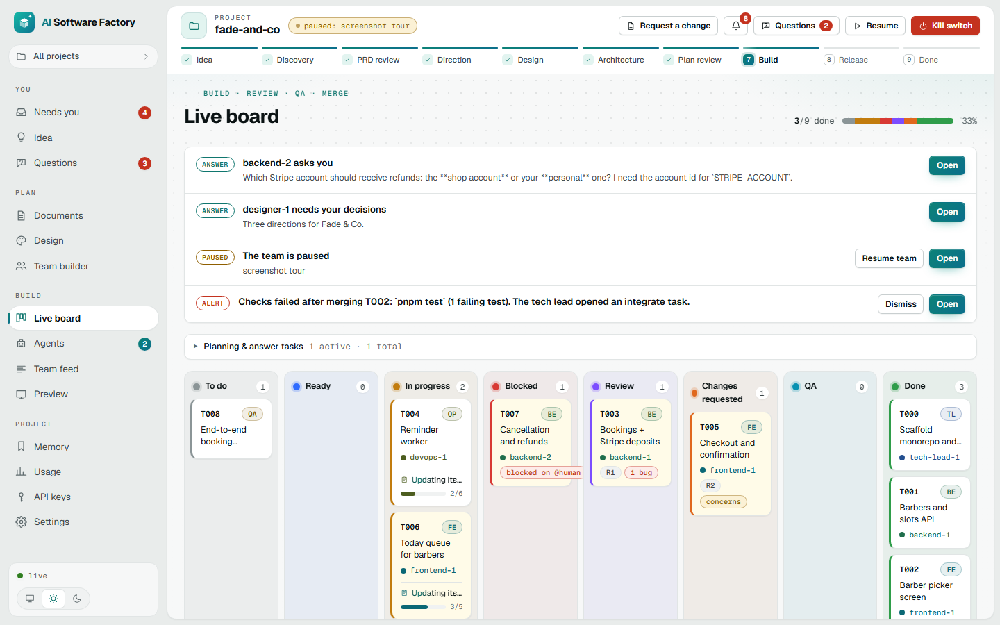
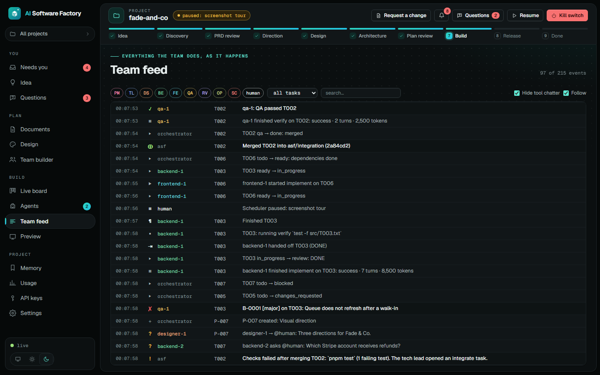
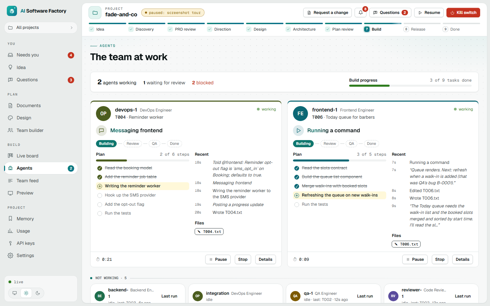
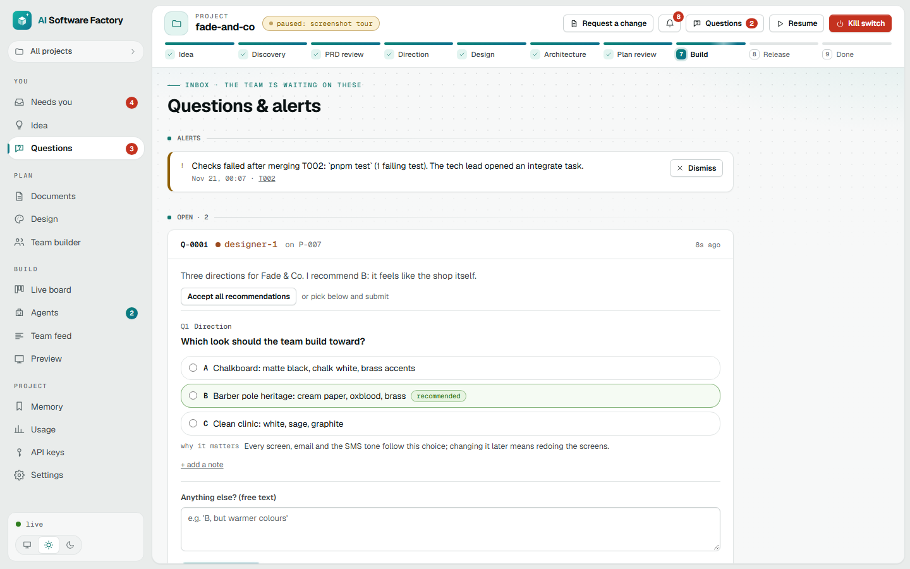
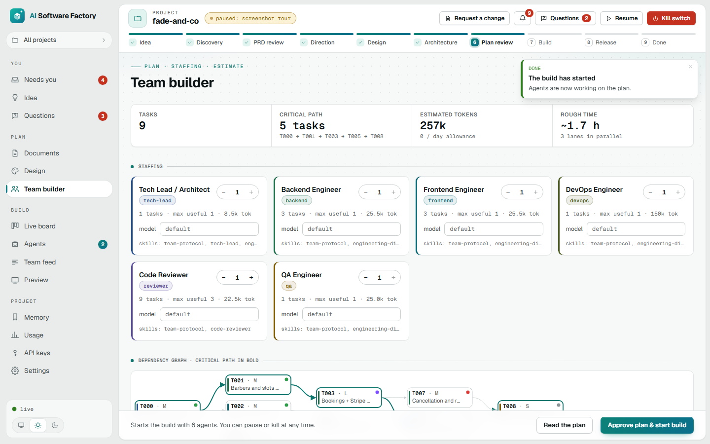
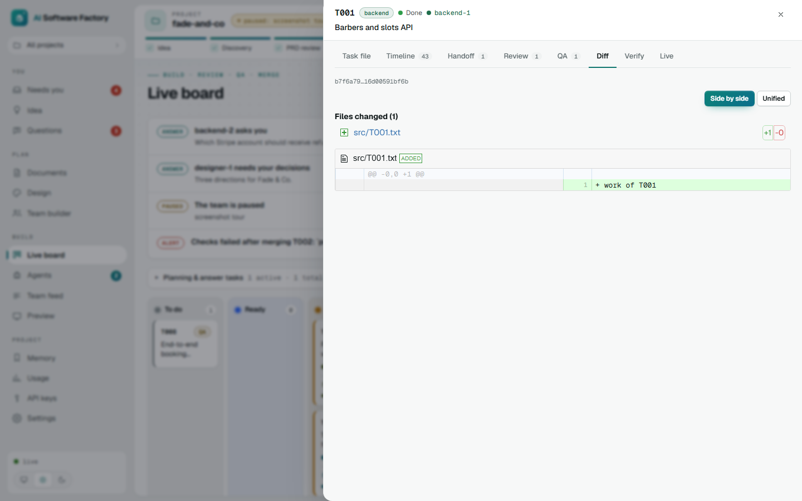
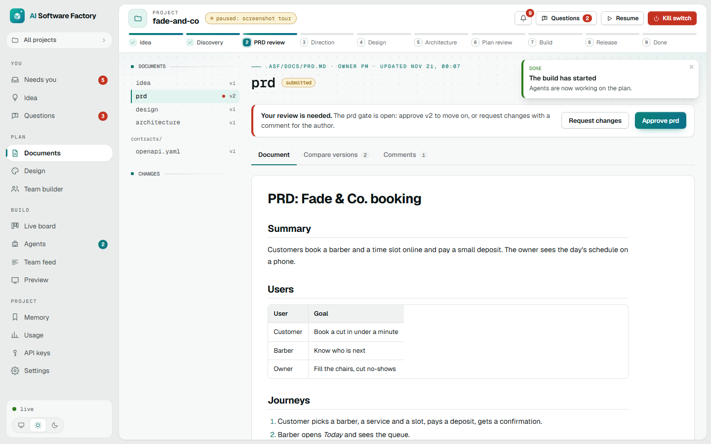

<div align="center">

<picture>
  <source media="(prefers-color-scheme: dark)" srcset="docs/brand/asf-logo-dark.svg">
  
</picture>

### Your whole AI software team, running on your own machine.

Describe an app in plain words. A product manager, tech lead, designer, engineers, QA, a code reviewer, and DevOps plan it with you and build it in parallel. You watch everything live and approve each step.

[](#requirements)
[](docs/claude-code-integration.md)
[](#safety-and-cost)
[](LICENSE)

[Quickstart](#quickstart) · [How it works](#how-it-works) · [Your first build](#your-first-build) · [Dashboard tour](#dashboard-tour) · [Commands](#commands) · [Safety and cost](#safety-and-cost) · [FAQ](#faq) · [Docs](docs/README.md)



</div>

---

## Contents

- [What is AI Software Factory?](#what-is-ai-software-factory)
- [Requirements](#requirements)
- [Quickstart](#quickstart)
- [Your first build](#your-first-build)
- [How it works](#how-it-works)
- [Dashboard tour](#dashboard-tour)
- [Commands](#commands)
- [Safety and cost](#safety-and-cost)
- [Configuration](#configuration)
- [FAQ](#faq) · [Troubleshooting](#troubleshooting)
- [Development](#development)
- [Usage and terms](#usage-and-terms)

---

## What is AI Software Factory?

AI Software Factory (`asf` for short) turns an AI model into a small software company that works for you. Every team member is either a headless **Claude Code** process (with your Claude subscription) or an agent on the **built-in engine**, which runs on free API keys or a model on your own computer, with no subscription at all ([how](docs/engine.md)). Each one follows a plain-markdown playbook (a "skill") that you can read and edit. Everything they do streams to a dashboard on `http://127.0.0.1`: files edited, commands run, messages, decisions, and reviews.

**What you get at the end:** a working, tested app in your own folder. The default stack is **Next.js + FastAPI + PostgreSQL**, with Docker Compose for local development and GitHub Actions CI. AI Software Factory never deploys anything.

### Just enough process

Before any work starts, the tech lead sizes each request, the way a real lead sizes a ticket:

| Track | For | What happens |
|---|---|---|
| ⚡ **Quick** | UI tweaks, copy changes, small fixes | The tech lead writes 1 to 3 tasks and an engineer does them right away. Each task's own checks must pass. There is no PRD, design, review round, or approval, and you get a "done" notification. |
| 📋 **Standard** | A feature that needs a short spec | You approve a one-page PRD, then a plan. The build then runs with review and QA. |
| 🏭 **Full** | A new product or a big feature | The whole flow below. |

Pick **Auto** (the default) to let the tech lead decide, or choose a track yourself. When a request is done, send the next one. You can cancel the current work at any time, and finished work stays.

### The full flow

1. **You write an idea** in plain words ("a booking app for my barbershop").
2. **The PM asks you one short batch of questions**, each with a recommended answer, then writes a PRD (product requirements document) for you to approve.
3. **The designer proposes 2 to 3 visual directions.** You pick one, and the designer produces design tokens and screen mockups.
4. **The tech lead writes the architecture and API contracts**, then a task plan. Code checks the plan: no dependency cycles, and no two parallel tasks editing the same files.
5. **You choose the team size**, and the build starts. Engineers work in parallel, **directly in your project folder**, like a team sharing one office. Each task owns its own files, so nobody steps on anyone else. Every task goes through **tests → code review → QA → done**, and the project's checks run after each one.
6. **You approve the release.** The finished app is already in your folder.

### Why AI Software Factory

| | |
|---|---|
| 🏠 **Local first** | Runs on your machine, binds to `127.0.0.1`, requires a random access token, and has no telemetry or cloud service. |
| 🔑 **Your subscription, or none** | Uses the official `claude` CLI with your own login, and never reads or stores your Claude credentials. No subscription? The built-in engine runs on free API keys from 14 providers (Gemini, Groq, OpenRouter, NVIDIA, Mistral, Z.ai, Cloudflare, and more, one even without a key) or a local model (Ollama, LM Studio). It picks a small model for light tasks and the strongest for complex ones, a team can pool each member's own keys, and work moves to the next model or key when one hits its limit. |
| 🧭 **You stay in charge** | Approval gates for the PRD, design, architecture, plan, and release, plus a kill switch. Agents ask you before anything that costs money, needs a key, or changes scope. |
| 🧱 **Real engineering, not vibes** | Contracts before code and test-first tasks. A `verify` command must pass before a task counts as done. Every task gets independent code review, QA with bug reports, and project checks after it finishes. |
| 👀 **Watch them work** | Each agent's card shows what it is doing in plain words ("Running the tests", "Messaging the frontend engineer"), its own plan as a live checklist with a progress bar, the files it touched, and where its task is. |
| 🔔 **Hear about what matters** | Pop-up and desktop notifications when something needs your approval, an agent asks you a question, a task is blocked, or a task is done. |
| 💸 **Easy on your usage** | Small changes skip the long process. Routine runs use a lighter model, and agents stop early when stuck. It pauses at Claude Code usage limits and resumes on its own. |
| ✏️ **Editable team** | Every role's behavior is markdown in [`skills/`](skills/). Change how your PM writes PRDs or how your reviewer judges code, right in the dashboard. |

### The team

| Role | What it does |
|---|---|
| **Product manager** | Turns your idea into clarifying questions and a PRD, and answers product questions during the build |
| **Tech lead** | Architecture, API and data contracts, the task plan, the app scaffold, integration fixes |
| **Designer** | Visual directions, design tokens, screen specs and HTML mockups, design review of built screens |
| **Backend engineer** | FastAPI endpoints, models, migrations, and tests |
| **Frontend engineer** | Next.js screens, components, and tests |
| **QA engineer** | Verifies each task in the running app, files bugs, writes end-to-end journey tests |
| **Code reviewer** | Read-only review of every task's diff, with severity-rated comments |
| **DevOps engineer** | Docker Compose, Dockerfiles, environment files, CI |
| **Security engineer** *(optional)* | Threat model and a pre-release audit |

---

## Requirements

| Tool | Why | Check |
|---|---|---|
| **Node.js 22.18+** | Runs AI Software Factory | `node --version` |
| **Git** (any recent version) | Agents run shell commands with its bash on Windows (Git Bash). AI Software Factory itself does not use git in your project | `git --version` |
| **Claude Code**, logged in, **or** a free API key | Runs the agents. Either [Claude Code](https://docs.claude.com/en/docs/claude-code) with your Claude subscription (run `claude` once to log in), or the **built-in engine** with a free key from Gemini, Groq, OpenRouter, Mistral, or Cerebras, or a local model with Ollama or LM Studio ([guide](docs/engine.md)) | `claude --version` or `asf keys` |
| **pnpm** | Installs AI Software Factory (ships with Node through corepack) | `corepack pnpm --version` |
| **Docker** with Compose | Gives each agent its own database for the apps it builds | `docker compose version` |
| **uv** | Python tooling for the default FastAPI backend ([install](https://docs.astral.sh/uv/)) | `uv --version` |

It runs on macOS, Linux, and Windows, and is developed on Windows with Git Bash. On Windows, [Git for Windows](https://git-scm.com/download/win) is required, because AI Software Factory and Claude Code use its `bash`. Docker and uv are only needed by the apps the team builds, so you can install them later.

---

## Quickstart

### Windows: double-click `run.bat`

Install [Node.js 22.18+](https://nodejs.org) and, if you have a Claude subscription, [Claude Code](https://docs.claude.com/en/docs/claude-code) (run `claude` once to log in). Then download or clone this repository and **double-click `run.bat`** in its folder.

The first time, it checks your tools, installs the dependencies, and builds the dashboard (a minute or two). Then it starts AI Software Factory and opens the dashboard in your browser, with the folder picker in `%USERPROFILE%\asf-projects`. Create a folder there for your app, or browse to any other folder. Keep the window open while you work, and press **Ctrl+C** in it to stop.

* To open a specific project right away, drag its folder onto `run.bat`.
* If port 4800 is busy, run `run.bat --port 4801` from a terminal.
* Double-clicking `run.bat` again while it's already running just opens the dashboard.

### Option A: let Claude Code set it up (recommended)

```bash
git clone <repo-url> ai-software-factory
cd ai-software-factory
claude
```

Then say **"set up AI Software Factory"**. Claude follows [`CLAUDE.md`](CLAUDE.md): it checks your prerequisites, installs everything, helps you pick a project folder, and starts the dashboard. It explains each step and asks before installing anything system-wide.

### Option B: set it up yourself

```bash
# 1. Get AI Software Factory and install it
git clone <repo-url> ai-software-factory
cd ai-software-factory
corepack pnpm install
corepack pnpm build          # builds the dashboard

# 2. Install the `asf` command so it works from any folder
node packages/cli/bin/asf.js setup
#    Windows: adds %USERPROFILE%\.asf\bin to your user PATH.
#    macOS / Linux: installs ~/.local/bin/asf (it tells you if that folder is not on your PATH).
#    Then open a NEW terminal.

# 3. Check your machine
asf doctor
```

From then on, use it from **any folder**:

```bash
cd ~/code/my-app        # a new, empty folder or an existing project
asf up                  # starts AI Software Factory and opens the dashboard for this folder
```

* In a folder that is already an AI Software Factory project, the dashboard opens that project.
* In any other folder, the dashboard opens a **folder picker** at that location. Browse, create a new folder, and choose where the app and all its files should go. The folder is set up for you.
* If you prefer the terminal, `asf init` does the same setup.

`asf up` prints a link like `http://127.0.0.1:4800/?token=…` and opens it in your browser. **Keep that terminal open: Ctrl+C stops AI Software Factory and every agent.** If it is already running, `asf up` in another folder just opens the dashboard there.

### No Claude subscription? Use free API keys

1. Open **API keys** in the dashboard, pick a provider (Gemini, Groq, OpenRouter, NVIDIA, Mistral, Z.ai, Cloudflare, and more, or Ollama / LM Studio on your own computer), follow its "Get a free key" link, and add the key under your name. Teammates add their own keys the same way, on the same computer.
2. In **Settings → Agent engine**, choose **Built-in engine**, pick a model or two from the live list, and save.
3. Send a small request first. Free tiers limit requests per day: the [built-in engine guide](docs/engine.md) explains how to choose models and make the limits last.

From a terminal: `asf keys providers`, then `asf keys add groq --label "Your name"`.

> [!TIP]
> Agents work **directly in the folder you choose**. AI Software Factory adds one hidden `.asf` folder (plans, documents, the team's notes) and nothing else: no git repository, branches, or commits. If your folder already uses git, it is left to you, and agents can only read it. To remove the global command, run `asf setup --uninstall`.

---

## Your first build

For a small change, type it on the Idea screen and leave the process on **Auto**, and it is built right away. The steps below are the **full** track for a new app. Start small: a good first app takes roughly 8 tasks, and [`examples/todo-with-auth.md`](examples/todo-with-auth.md) is one you can paste in.

1. **Keep it small at first.** In **Settings**, keep *max concurrent agents* at 2 or 3 and leave every approval gate on.
2. **Idea.** Describe the app, add screenshots or links if you have them, choose a stakes level, and submit.
3. **Questions.** The PM sends one batch of questions, each with a recommended option and why it matters. Answer them, or click **Accept all recommendations**.
4. **PRD.** Read it in **Documents**. Click **Approve**, or **Request changes** with comments, and the PM revises it.
5. **Design.** Each visual direction comes with a live preview of your main screen, so you choose from something you can see. The designer then produces tokens and a mockup of every screen. **Review the mockups at desktop and mobile sizes and approve the design** (or ask for changes) before any architecture or code is written.
6. **Architecture.** Review the tech lead's architecture and API contract, then approve it.
7. **Plan and team.** **Team builder** shows every task, the dependency graph, the critical path, and a rough time estimate. Pick how many agents per role (agents beyond the plan's parallel lanes just wait), then click **Approve plan & start build**.
8. **Watch the build.**
   * **Agents** shows the team at work: each agent's status in plain words, its plan as a checklist with a progress bar, the files it touched, and its task's stage. Open **Details** on a card for the full live transcript: reasoning, each edit, each command and its output.
   * On the **Live board**, tasks move from *To do* to *Done*.
   * The **Team feed** shows agents messaging each other, reviews, and blocked actions.
   * Notifications pop up when an agent asks you something, a document needs your approval, a task is blocked, or a task is done. The screen each one belongs to is highlighted in the sidebar until you open it, and opening a notification marks it read. You can turn on desktop notifications from the bell.
   * **Changed your mind?** Click **Request a change** in the header any time after the PRD is approved. The PM updates the PRD and the tech lead updates the plan, each for your approval, and new tasks join the build. Finished work is kept unless your change says otherwise.
9. **Release.** QA runs the full suite on the finished project, and AI Software Factory writes a release summary for you to approve. Everything is already in your folder.

---

## How it works

```mermaid
flowchart LR
  idea([Your idea]) --> pm[PM questions]
  pm --> prd[PRD]
  prd -->|you approve| dir[Design directions<br/>+ live previews]
  dir -->|you pick| mock[Tokens + screen mockups]
  mock -->|you approve| arch[Architecture<br/>+ contracts]
  arch -->|you approve| plan[Task plan]
  plan -->|you approve + pick team| build
  subgraph build[Parallel build]
    direction LR
    eng[Engineer<br/>test first, verify] --> rev[Code review] --> qa[QA] --> done[Done + project checks]
  end
  build --> journey[QA journey tests<br/>optional security audit]
  journey -->|you approve| release([Release])
```



* **Every agent is a real Claude Code session.** AI Software Factory starts `claude -p` in your project folder with that role's skills added to its system prompt, a scoped access token, and its own ports and Docker Compose project.
* **Parallel agents never collide.** Each task owns its files. The scheduler never runs two tasks that own the same file, and a guard hook stops edits outside a task's files.
* **No git machinery.** Agents don't create branches or commits. To show what a task changed (for review and for you), AI Software Factory copies the task's files when it starts and diffs against that copy.
* **Agents share state only through the `asf` CLI:** `asf task done`, `asf ask @human`, `asf msg @frontend`, `asf review approve`, and so on ([reference](skills/team-protocol/references/asf-cli.md)). The server checks role permissions on every command.
* **Plain code makes the decisions.** Scheduling, permissions, and plan validation are deterministic code, not an LLM. A task is "done" only when its `verify` command passes, review approves it, and QA passes it. If the project's checks fail afterwards, the tech lead gets a repair task.
* **Everything is visible.** Each agent's actions, messages, decisions, reviews, and raw output are stored and streamed to the dashboard, and survive a page reload.
* **Only what you asked for.** Every role follows a scope rule: build exactly what you said and what you approved. Anything an agent thinks is missing becomes a question or a "Later" note you can see, never a silent extra. Reviewers flag unrequested additions.
* **The team learns.** When an agent, a reviewer, or you spot a mistake that could happen again, it becomes a one-line lesson in the project's memory. Every later run sees the lessons that match its role and files, so mistakes are not repeated (and you don't pay to fix them twice). Edit the memory on the **Memory** screen.
* **Token-thrifty teamwork.** Each role's system prompt is identical across runs, so Claude Code's prompt cache is reused. Messages are short and capped (details go in files). Questions to the same role are answered in one batched run, and inboxes are trimmed. Interrupted agents resume their own sessions instead of starting over.

### Existing projects

Run `asf up` (or `asf init`) inside a folder that already has code. On your first request the **tech lead surveys the codebase**: stack, layout, conventions, and the exact test and build commands. The survey goes into a short `codebase.md` that every agent reads instead of exploring again. The PM then plans **only the change you asked for** (a feature or a fix). There is no scaffold, and your project's own checks run after every finished task. Agents edit your files directly, so keep a backup (or commit, if you use git) before a big change.

📚 More detail: [Architecture](docs/architecture.md) · [How it uses Claude Code](docs/claude-code-integration.md) · [Security review](docs/security-review.md) · [Design decisions](docs/decisions/) · [All docs](docs/README.md)

---

## Dashboard tour

| Screen | What you do there |
|---|---|
| **Idea** | Describe the app and add attachments and links |
| **Needs you** | Everything waiting on you in one list, with one-click actions: questions, approvals, blocked or paused tasks, and alerts (also shown at the top of the board) |
| **Questions** | Answer batched questions (with recommendations) and anything an agent asks `@human`, and see alerts |
| **Documents** | Read the PRD, architecture, contracts (OpenAPI rendered), decisions, and plan. Compare versions, comment, approve |
| **Design** | Compare live previews of each direction, browse tokens, review every screen mockup at desktop and mobile sizes, and approve the design |
| **Team builder** | Task graph, critical path, and estimate. Choose agents per role and models, then start the build |
| **Live board** | Kanban of every task. Open one for its file, timeline, handoff, review, QA report, diff, and verify output |
| **Agents** | Watch agents work in real time: a live transcript per agent (its reasoning, each edit with an inline diff, each command and its output) and elapsed time. Pause or stop one agent |
| **Team feed** | Everything the team does, as it happens. Filter by role or task |
| **Preview** | Run the finished app (Docker) and use it in the dashboard |
| **Memory** | The lessons the team learned on this project. Add, pin, or remove them |
| **Usage** | Tokens, runs, and cost per day and per role, against your optional daily budget |
| **API keys** | The team's own keys for the built-in engine: add one under your name, test it, see each key's status (ready, limited until a time, rejected) and today's use per teammate |
| **Settings** | The agent engine (Claude Code or built-in, and the built-in engine's models), concurrency, gates, QA per task, models per role, preview command, permission mode, check commands, and the **skills editor** |

The header always shows the phase, open questions, notifications, **Request a change**, **Pause/Resume**, and the red **Kill switch**.

<details>
<summary><b>More screenshots</b></summary>

**Team feed** (dark theme)


**Agents at work**


**Questions with recommendations**


**Team builder with the task graph**


**Task diff**


**Documents**


</details>

---

## Commands

| Command | What it does |
|---|---|
| `asf setup [--uninstall]` | Install (or remove) the global `asf` command so it works from any folder |
| `asf init [folder]` | Make a folder an AI Software Factory project (adds only the hidden `.asf/` folder) |
| `asf doctor [--login] [--keys]` | Check prerequisites and print fixes. `--login` also confirms Claude Code is logged in (asks first, then sends one tiny prompt). `--keys` checks every API key with its provider (uses no tokens) |
| `asf keys [list\|add\|test\|remove\|providers]` | The team's API keys for the built-in engine. `asf keys add groq --label "Your name"` asks for the key |
| `asf up [--port N] [--no-open]` | Start the server and dashboard on `127.0.0.1` (default port 4800) |
| `asf status` | Phase, task counts, and working agents for the current project |
| `asf pause` / `asf resume` | Stop / restart starting new agent runs |
| `asf stop` | **Kill switch:** stop every agent process immediately |
| `asf logs <agent\|task> [-f]` | Recent events for an agent (`backend-1`) or a task (`T012`) |

Agents use the same binary for their own commands (`whoami`, `task`, `msg`, `ask`, `review`, `qa`, ...). You normally never need those. Run `asf help` for the full list.

---

## Safety and cost

### What agents can and cannot do

A guard hook runs before every file edit and shell command an agent makes. It blocks the action, with a clear reason, when the agent tries to:

* write outside your project folder, or outside the files its task owns (the code reviewer can't edit code at all);
* change git state (add, commit, reset, checkout, push...) in your project;
* delete files outside the project folder, or wipe another agent's Docker volumes;
* call the internet with `curl`/`wget` (localhost only, unless a task allows it);
* read Claude credentials or the team's API keys, or touch AI Software Factory's own database.

With the built-in engine, the same checks run inside AI Software Factory before every tool call.

Everything else in the shell is allowed, as in Claude Code, so agents can install packages, run tests, and start the app without being stopped. Destructive or paid actions need your approval.

> [!WARNING]
> AI Software Factory is a policy sandbox, not an operating-system sandbox: agents run as your user. For untrusted ideas, run it in a VM or container. See the [security review](docs/security-review.md).

### What it costs

With Claude Code, every agent run uses your Claude subscription (or API billing, if you set that up in Claude Code). With the built-in engine, it uses the free allowance of the team's API keys, or nothing at all with a local model; the Team builder estimates the API requests a build needs, and requests are trimmed to stay small ([guide](docs/engine.md#making-free-limits-last)). These controls keep it in check:

* **Just enough process:** small changes go straight to an engineer. Only big requests get questions, a PRD, design, and architecture.
* **Lighter model for routine runs:** sizing a request, answering teammates, code review, and QA checks use Sonnet, unless you choose a model per role in Settings.
* **Concurrency:** a global cap (default 3) and per-role counts from the team builder.
* **Usage limits:** when Claude Code reports a limit, AI Software Factory pauses, shows the reset time, and resumes on its own afterwards (you can turn this off).
* **Runaway guards:** turn limits per role, a time limit per run, and blocking of any task that fails 3 times in a row until you look at it.
* **Optional daily cap:** an optional daily token cap in Settings, off by default.

---

## Configuration

Most settings live in the dashboard (**Settings**) and are stored per project:

| Setting | Default | Notes |
|---|---|---|
| Agent engine | Claude Code | Or the built-in engine, on the team's API keys: then main and quick models (ordered `provider:model` lists; optional), automatic model choice by task (small models for light work, the strongest for complex work; on), the size of each request (32k tokens), and turns per run (50) |
| Max concurrent agents | 3 | Total agents running at once |
| Daily token cap | off | Optional. No new runs start once the cap is reached |
| Approval gates | all on | PRD, design direction, screen designs, architecture, plan, release. Each can auto-approve |
| Models per role | Claude Code default | For example a stronger model for the tech lead and a faster one for the reviewer |
| Max turns per role, run timeout | 80 turns / 45 min | Runaway guards |
| Permission mode | `dontAsk`, shell allowed | Claude Code's tools are allowed, and the guard hook decides what is unsafe. `bypassPermissions` is available with a warning |
| Check commands | from the scaffold or codebase survey | Run on the project after every finished task |
| QA per task, security audit | on / off | |

Role definitions, write paths, and the default stack are in [`roles.yaml`](roles.yaml). Role behavior is in [`skills/`](skills/). To change it for one project, edit it in **Settings → Skills** (you can reset to the default). The project then gets its own copy in `.asf/skills/`.

### What AI Software Factory adds to your project

```
my-app/                    your project: the agents' code goes here, like any developer's
  .asf/                    the one hidden folder AI Software Factory adds
    asf.db                 the task board, messages, reviews, and history
    docs/                  PRD, design, architecture, contracts, decisions
    tasks/                 the task plan
    handoffs/, reviews/    the team's notes
    snapshots/             copies of each task's files from when it started (for "what changed")
    runs/                  each agent run's prompt and raw output
    sessions/              built-in engine conversations, for resuming
```

Per-user state (the list of your projects, the running server's address, and the team's API keys for the built-in engine) lives in `~/.asf/`.

---

## FAQ

<details>
<summary><b>Is this an official Anthropic product?</b></summary>

No. AI Software Factory is an independent open-source project that runs the official Claude Code CLI. See [Usage and terms](#usage-and-terms).
</details>

<details>
<summary><b>Does it send my code anywhere?</b></summary>

With Claude Code, only Claude Code talks to Claude, exactly as when you use `claude` yourself. With the built-in engine, what agents read is sent to the provider you chose (free tiers may keep prompts; see [Privacy](docs/engine.md#privacy)), or nowhere with a local model. The server listens on `127.0.0.1`, requires a token, and has no telemetry.
</details>

<details>
<summary><b>Can I use it without a Claude subscription?</b></summary>

Yes. Choose the **built-in engine** in Settings and add free API keys (Gemini, Groq, OpenRouter, NVIDIA, Mistral, Z.ai, Cloudflare, and more: the [guide](docs/engine.md#free-providers) lists 14) on **API keys**, or run a model on your own computer with Ollama or LM Studio. A team can each add their own key on the computer that runs AI Software Factory. Free models are weaker than Claude at long builds: small and medium requests work well. See the [built-in engine guide](docs/engine.md).
</details>

<details>
<summary><b>Can I use a different stack?</b></summary>

Yes. Tell the PM in your idea or answers (for example "use Django and Vue"). The tech lead records the stack in the architecture, and the skills adapt. The built-in skills have the most detail for the default stack.
</details>

<details>
<summary><b>Can I add it to an existing app?</b></summary>

Yes. Run `asf up` in the project folder and open it from the dashboard (or run `asf init` there). The tech lead surveys the code first, and the team changes only what you ask for. Agents edit your files directly, so back up (or commit) your work before you start. See [Existing projects](#existing-projects).
</details>

<details>
<summary><b>Can I change the plan once the build has started?</b></summary>

Yes. Use **Request a change** in the header. The PM updates the PRD and the tech lead updates the plan, each with your approval. Tasks already finished are kept, and new tasks wait until you approve the updated plan.
</details>

<details>
<summary><b>An agent is stuck or looping. What do I do?</b></summary>

Open its card on **Agents** to see the raw output, or the task on the **Live board** for its verify output. You can pause that agent, unblock or hold the task, answer its question, or hit the kill switch. Tasks that fail three times stop on their own and alert you.
</details>

<details>
<summary><b>What happens if I close the terminal or my machine restarts?</b></summary>

Agents stop. Run `asf up` again and nothing is lost: interrupted tasks resume their own sessions, and the board picks up where it left off.
</details>

<details>
<summary><b>Can I change how the agents behave?</b></summary>

Yes, that is what skills are for. Edit them per project in **Settings → Skills**, or edit [`skills/`](skills/) before `asf init` to change the defaults.
</details>

<details>
<summary><b>Can I use Codex or another agent CLI?</b></summary>

Not as such, but the built-in engine runs agents on any OpenAI-compatible API (including OpenAI's own, as a custom provider). Other agent CLIs can be added behind the same runner interface.
</details>

---

## Troubleshooting

| Problem | Fix |
|---|---|
| `asf doctor` says Claude Code is missing | Install Claude Code, run `claude` once to log in, then `asf doctor --login`. Or use the built-in engine with free API keys: `asf keys providers` |
| Paused: "No working API key" | Add or fix a key on **API keys** (or `asf keys test`), check the models in **Settings → Agent engine**, then click **Resume** |
| Header: "waiting for usage limits until …" | Every key (or your Claude account) has hit its limit. The agents carry on by themselves at that time, without starting over. To go on sooner, add a key from another provider (it is tried at once) or click **Try now** |
| Built-in engine: agents finish without doing the work | The model is too small or cannot call tools. Choose a bigger model with tool calling ([guide](docs/engine.md#choosing-models)) |
| The dashboard says "open the link printed by asf up" | The page needs the token. Use the full link from the terminal, or run `asf up` again to print it |
| Port 4800 is in use | `asf up --port 4801` |
| Backend tasks fail with "uv: command not found" | Install [uv](https://docs.astral.sh/uv/) and restart `asf up` |
| Agents can't start databases | Start Docker Desktop (or the Docker daemon) and check `docker compose version` |
| AI Software Factory paused itself | Check the header. The cause is a Claude Code usage limit (it resumes on its own), the optional daily cap in Settings, or the kill switch (run `asf resume`) |
| Paused: "Claude Code is not logged in" | Run `claude` in a terminal, type `/login` and sign in, then click **Resume** (or run `asf resume`). `asf doctor --login` confirms the login works |
| A task is blocked with only "run failed" | Open the task's run on **Agents**, or read `.asf/runs/<run>/stream.jsonl` in your project folder. The last lines say why Claude Code stopped |
| `asf: command not found` | Open a new terminal after `asf setup`, or run `node <repo>/packages/cli/bin/asf.js <command>` |
| `pnpm: command not found` | Use `corepack pnpm …`, or run `corepack enable` once |

---

## Development

```bash
corepack pnpm install
corepack pnpm check                          # typecheck + lint + unit and end-to-end tests (fake claude: no quota)
corepack pnpm test:e2e                       # dashboard browser tests (Playwright)
corepack pnpm --filter @asf/dashboard dev    # dashboard dev server (proxies to a running `asf up`)
```

| Package | |
|---|---|
| `packages/core` | Pure logic: plan validation, collision checks, scheduler, permissions, guard, stream parsing, database schema, and the built-in engine's key selection, rate-limit parsing, and trimming |
| `packages/server` | API, WebSocket events, orchestrator, agent runners (Claude Code and the built-in engine), snapshots (plus an optional isolated git-worktree mode) |
| `packages/cli` | The `asf` command (owner and agent commands, guard hook) |
| `packages/dashboard` | React + Vite + Tailwind dashboard |
| `packages/fake-claude` | Stand-ins used by every test: for `claude`, and (fake-llm) for an OpenAI-compatible provider |

Node runs the TypeScript directly, and only the dashboard is built. Tests never call the real Claude or any real provider. See [CONTRIBUTING.md](CONTRIBUTING.md) and the [docs index](docs/README.md).

---

## Usage and terms

AI Software Factory runs the official Claude Code CLI on your own machine, using your own Claude account and subscription (or API billing, if you configure that in Claude Code). Every agent run counts toward your Claude usage. AI Software Factory gives you budgets, a reserve, concurrency caps, and a kill switch, but **you are responsible for your usage and for complying with Anthropic's current terms of service and usage policies** for Claude and Claude Code.

With the built-in engine, agents use the API keys you and your teammates add, and each key's use is covered by **its owner's agreement with that provider**. Use your own key; some providers do not allow sharing a key, and creating several accounts to get around a free limit breaks almost every provider's terms.

AI Software Factory is an independent open-source project and is **not affiliated with, endorsed by, or sponsored by Anthropic**. "Claude" and "Claude Code" are trademarks of Anthropic and are used here only to describe compatibility.

AI Software Factory does not deploy software or use paid third-party services on its own. Anything that costs money or touches real external services requires your explicit approval.

## Credits and license

The role skills were shaped by ideas from several open-source projects; see [CREDITS.md](CREDITS.md). Logo and brand assets: [docs/brand](docs/brand/README.md).

Released under the [MIT License](LICENSE).
