# Architecture — AI Software Factory

> **Status:** Phase 1 is implemented; §§2-4, 9.1 and 11 now describe running code.
> Everything from Phase 2 onward — the agent runtime, secrets, realtime, deployment — remains
> design of record. Sections describing unbuilt phases are marked. As phases land, this file
> must be rewritten to describe **what exists**. See [instructions.md](instructions.md) §9.

**Last verified against upstream ecosystem:** 2026-08-23.

---

## 1. What this system is

A **hierarchical, supervised, multi-agent software engineering organization**. A user describes an
application in natural language; the platform interrogates the request for gaps, collects
configuration and credentials securely, plans an architecture, decomposes the work, delegates it
through a chain of supervisors to specialized worker agents, generates and tests code in an isolated
workspace, provisions a database, applies migrations, deploys to real providers, verifies health,
and returns live URLs — pausing for human approval at every high-risk boundary.

The distinguishing property is **supervision**, not agent count. Every unit of work is assigned by a
supervisor, validated by that supervisor, and either accepted, retried, reassigned, or escalated.
Failure is a first-class control-flow path, not an exception that aborts the run.

### 1.1 Two systems, never confused

This codebase contains two distinct things, and conflating them is the most common way to write a
security hole:

| | **The Platform** | **Generated Projects** |
|---|---|---|
| What | The factory itself (this repo) | Applications the factory produces |
| Trust | Trusted, human-written | **Untrusted**, LLM-written |
| Runs on | Platform infrastructure | Isolated workspace / customer providers |
| Database | Platform Neon project | Per-project Neon project |
| Code execution | Normal process | Sandboxed container, no host access |

Throughout this document, "project" means *a user's generated application*, and "platform" means
*the factory*.

---

## 2. High-level architecture

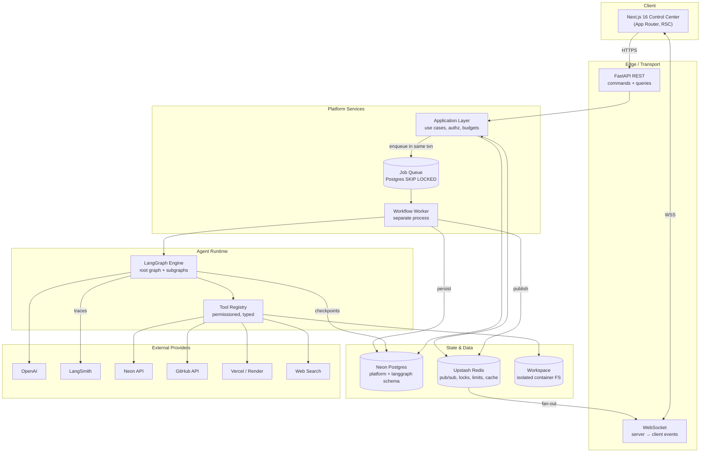

**The load-bearing decisions visible above:**

1. **The API process never runs a graph.** Workflow runs last minutes to hours. They execute in a
   separate worker process, dispatched through a durable queue. An API restart cannot kill a run.
2. **The queue lives in Postgres.** Enqueuing a run happens in the *same transaction* as the domain
   write that justifies it, which removes the dual-write problem entirely. At our volume (tens of
   runs per hour, not thousands per second) Postgres `SELECT … FOR UPDATE SKIP LOCKED` is
   comfortably sufficient and one less thing to be down.
3. **Redis is for what Postgres is bad at:** cross-replica pub/sub fan-out, rate limiting,
   distributed locks, and TTL caching. It is never the source of truth. If Redis is down, event
   delivery degrades to polling and the run still completes.
4. **Events are persisted before they are published.** A reconnecting browser replays from a
   sequence number rather than losing history.

---

## 3. Monorepo structure

```
ai-software-factory/
├── apps/
│   ├── api/                       # FastAPI process — thin transport layer only
│   │   ├── src/factory_api/
│   │   │   ├── main.py            # app factory
│   │   │   ├── lifespan.py        # startup/shutdown: pools, redis, registries
│   │   │   ├── middleware/        # request-id, logging, auth ctx, rate limit, errors
│   │   │   ├── dependencies/      # DI providers (session, current_user, project guard)
│   │   │   ├── routers/           # auth, projects, chat, specs, runs, approvals,
│   │   │   │                      # secrets, deployments, events, health
│   │   │   ├── schemas/           # request/response DTOs — NEVER domain models
│   │   │   ├── ws/                # connection manager, ticket auth, replay
│   │   │   └── errors.py          # exception → HTTP envelope mapping
│   │   └── tests/
│   ├── worker/                    # Workflow executor process
│   │   ├── src/factory_worker/
│   │   │   ├── main.py            # entrypoint, signal handling
│   │   │   ├── dispatcher.py      # claim loop (SKIP LOCKED), lease renewal
│   │   │   ├── handlers/          # one module per job type
│   │   │   └── shutdown.py        # graceful drain, checkpoint flush
│   │   └── tests/
│   └── web/                       # Next.js 16 control center
│       ├── src/app/               # App Router routes
│       ├── src/features/          # feature-sliced: projects, runs, approvals, deploy
│       ├── src/components/        # shared UI primitives
│       ├── src/lib/               # api client, ws client, event store, auth
│       ├── tests/                 # unit/component (Vitest + Testing Library)
│       └── e2e/                   # Playwright
├── packages/
│   ├── core/                      # factory_core — NO LangGraph, NO FastAPI imports
│   │   ├── src/factory_core/
│   │   │   ├── config/            # Pydantic Settings, env layering
│   │   │   ├── domain/            # entities, value objects, domain events, policies
│   │   │   ├── application/       # use cases, ports (protocols), unit of work
│   │   │   ├── persistence/       # SQLAlchemy models, repositories, session
│   │   │   ├── security/          # hashing, jwt, envelope crypto, redaction
│   │   │   ├── events/            # event schemas, bus, publisher, store
│   │   │   ├── infrastructure/    # redis, queue, providers (neon/github/vercel/render)
│   │   │   ├── observability/     # structlog, correlation, metrics, tracing
│   │   │   └── errors/            # error taxonomy, codes
│   │   ├── migrations/            # Alembic
│   │   └── tests/
│   ├── agents/                    # factory_agents — the LangGraph layer
│   │   ├── src/factory_agents/
│   │   │   ├── runtime/           # model registry, prompt registry, budget guard,
│   │   │   │                      # structured output, retry, callbacks
│   │   │   ├── state/             # graph state schemas + reducers
│   │   │   ├── graphs/            # root + subgraph builders
│   │   │   ├── supervisors/       # executive + department supervisors
│   │   │   ├── workers/           # specialized worker agents
│   │   │   ├── tools/             # typed, permissioned tools by domain
│   │   │   └── prompts/           # versioned prompt files (agent/vN.md)
│   │   └── tests/
│   └── contracts/                 # @factory/contracts — generated TS types (never hand-edited)
├── infra/
│   ├── docker/                    # platform images
│   ├── compose/                   # local dev stack
│   ├── sandbox/                   # generated-code execution image + seccomp/limits
│   └── providers/                 # provider config templates
├── scripts/                       # dev, codegen, db, seed, verify-phase
├── docs/
│   ├── adr/                       # architecture decision records
│   ├── runbooks/                  # operational procedures
│   └── evaluation/                # LangSmith datasets + evaluator specs
├── tests/                         # cross-cutting end-to-end suites
├── pyproject.toml                 # uv workspace root
├── pnpm-workspace.yaml
└── CLAUDE.md plan.md instructions.md features.md architecture.md README.md
```


### 3.0 As built (Phase 1)

The tree above is the target. What exists today:

```
apps/api/src/factory_api/     main, lifespan, state, errors, middleware/,
                              dependencies/, routers/, schemas/
apps/worker/src/factory_worker/  runner (process shell only; the queue is Phase 2)
apps/web/src/                 app/ (App Router), features/, components/ui/, lib/
packages/core/src/factory_core/  config/, domain/, application/, persistence/,
                              security/, observability/, errors/, testing/, runtime.py
packages/contracts/src/       api.ts (generated), index.ts (named re-exports)
```

Two additions the plan did not anticipate:

* **`packages/core/src/factory_core/testing/`** — in-memory repository fakes, shipped in
  the package rather than a test directory so `core` and `api` share one implementation.
  Two copies of a fake drift, and a drifted fake tests itself rather than the system.
* **`packages/core/src/factory_core/runtime.py`** — event loop selection. psycopg cannot
  use Windows' default `ProactorEventLoop`, and uvicorn ignores the asyncio policy, so both
  a policy and an explicit loop factory are required.

`packages/agents/` does not exist yet; it arrives with the agent runtime in Phase 3.

### 3.1 Why `core` and `agents` are separate packages

`core` must not import LangGraph, and `agents` must not import FastAPI. This is enforced by an
import-linter contract in CI, not by convention.

The payoff is concrete: domain rules (what makes a migration destructive, whether a user may act on
a project, how a budget is computed) are testable with no LLM, no graph, and no HTTP. The agent
layer becomes a *consumer* of the domain rather than the place where business logic accidentally
accumulates inside a prompt.

---

## 4. Layering

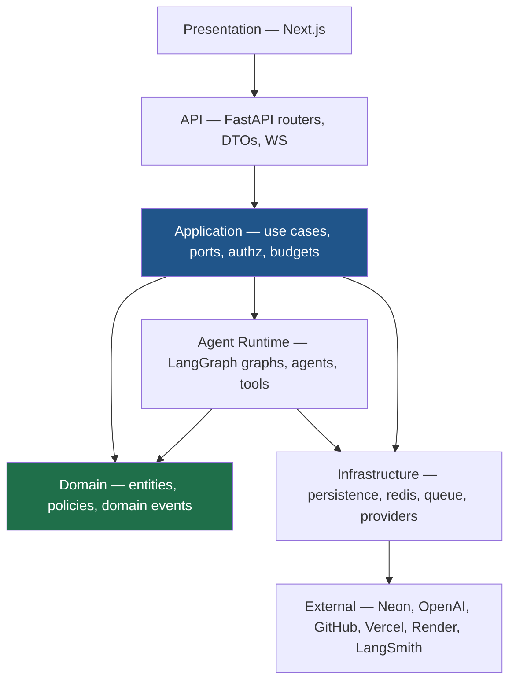

**Dependency rule:** arrows point inward or sideways-down only. Domain depends on nothing.
Application depends on domain and on *ports* (Python `Protocol`s), never on concrete adapters.
Infrastructure implements ports. The agent layer sits beside the application layer — it is an
execution strategy, not a data owner: **agents never write to the database directly**, they return
structured results that application services persist.

That last rule is what makes runs replayable and auditable. If an agent could write anywhere, the
checkpointed graph state and the database could disagree after a crash.

---

## 5. Agent hierarchy

18 roles: 1 executive, 4 department supervisors, 13 workers. Every role listed here earns its place;
several plausible agents were deliberately *not* created (see §5.4).

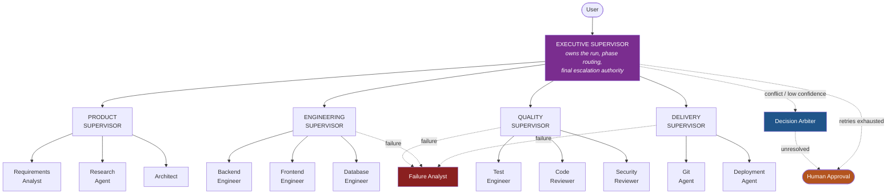

### 5.1 Every agent's contract

No agent may exist without all ten of these declared in code (`AgentSpec`), not in a docstring:

```python
class AgentSpec(BaseModel):
    role: AgentRole
    supervisor: AgentRole | None  # None only for EXECUTIVE
    responsibility: str  # one sentence, single concern
    input_schema: type[BaseModel]
    output_schema: type[BaseModel]
    allowed_tools: frozenset[str]  # enforced at call time, not suggested
    max_risk_level: RiskLevel  # ceiling on tools it may invoke
    state_reads: frozenset[str]  # graph state keys it may read
    state_writes: frozenset[str]  # graph state keys it may write
    failure_mode: FailureMode  # FAIL_TASK | DEGRADE | ESCALATE
    retry_policy: RetryPolicy  # attempts, backoff, retryable error classes
    escalation_target: AgentRole | Literal["HUMAN"]
    model_tier: ModelTier  # ROUTING | STANDARD | FLAGSHIP
    budget: AgentBudget  # token / call / wall-clock ceiling
```

### 5.2 Role summary

| Role | Responsibility | Key outputs | Escalates to |
|---|---|---|---|
| **Executive Supervisor** | Owns run lifecycle, phase transitions, cross-department conflicts, final escalation | `RunPlan`, phase decisions | HUMAN |
| **Product Supervisor** | Turns a vague request into a validated, complete specification | `ProjectSpecification` | Executive |
| **Engineering Supervisor** | Decomposes the architecture into implementation tasks, schedules parallel work, validates code output | `TaskGraph`, accepted artifacts | Executive |
| **Quality Supervisor** | Owns the verification gate; nothing ships without its pass | `QualityReport`, gate verdict | Executive |
| **Delivery Supervisor** | Repository, environments, migrations, deployment, health | `DeliveryReport` | Executive / HUMAN |
| Requirements Analyst | Extracts requirements, finds gaps, generates the question set | `RequirementSet`, `GapList` | Product |
| Research Agent | Answers "what is current/true externally?" with cited, cached sources | `ResearchReport` | Product |
| Architect | System design, data model, **the OpenAPI contract**, tech decisions with rationale | `ArchitectureDocument`, `openapi.json` | Product |
| Backend Engineer | FastAPI implementation against the contract | file writes, `EnvContract` | Engineering |
| Frontend Engineer | Next.js implementation against the contract | file writes, `EnvContract` | Engineering |
| Database Engineer | Models, schema, indexes, migrations, seed data | models, migration revisions | Engineering |
| Test Engineer | Generates unit/integration/API/component tests | test files, coverage target | Quality |
| Code Reviewer | Correctness, structure, file-size, standards conformance | `ReviewFindings` | Quality |
| Security Reviewer | Vulnerabilities, secret leakage, dependency risk — **can hard-block delivery** | `SecurityFindings` | Quality / HUMAN |
| Git Agent | Repo init, branching, conventional commits linked to task IDs, push, PRs | commit SHAs | Delivery |
| Deployment Agent | Provider API orchestration, env injection, build monitoring, rollback | `DeploymentRecord` | Delivery / HUMAN |
| Decision Arbiter | Resolves conflicting recommendations by demanding justification, then deciding or escalating | `Decision` w/ confidence | HUMAN |
| Failure Analyst | Classifies a failure, finds root cause, proposes a remediation with confidence | `FailureDiagnosis` | calling supervisor |

### 5.3 The delegation protocol

Supervisor↔worker communication is a typed contract, never free text:

```python
class TaskAssignment(BaseModel):
    task_id: UUID
    run_id: UUID
    assigned_to: AgentRole
    objective: str
    acceptance_criteria: list[str]  # supervisor validates against these
    context_refs: list[ArtifactRef]  # pointers, not inlined blobs
    secret_refs: list[SecretRef]  # secret://… — never values
    constraints: TaskConstraints  # budget, timeout, allowed tools
    attempt: int
    prior_failures: list[FailureDigest]  # so retries aren't blind repeats


class TaskResult(BaseModel):
    task_id: UUID
    status: Literal["succeeded", "failed", "needs_input", "blocked"]
    artifacts: list[ArtifactRef]
    self_assessment: SelfAssessment  # agent's own confidence + caveats
    failure: FailureDigest | None
    usage: UsageRecord
```

`prior_failures` is the difference between a retry loop and a retry *strategy*: attempt 2 is told
exactly how attempt 1 failed.

### 5.4 Agents deliberately not created

Recording these prevents them from being re-proposed later:

- **Static Analysis Agent** — running `ruff`/`mypy`/`tsc`/`eslint` and parsing output is
  deterministic. It is a node with tools, not an LLM. An LLM here adds cost, latency, and the
  ability to be wrong about something a compiler already knows.
- **Integration Engineer** — eliminated by making the Architect produce the OpenAPI contract
  *first*. Backend and frontend implement against the same contract, and a deterministic conformance
  checker verifies it. Agreement by construction beats agreement by negotiation.
- **Environment Agent** — each engineer emits a declarative `EnvContract` as part of its structured
  output. Assembling `.env.example` and provider env payloads from those is deterministic.
- **Health Check Agent** — HTTP probes with expected status/latency/body assertions. Pure code.
- **Monitoring / Documentation / DevOps agents** — folded into Delivery Supervisor and deterministic
  generators. They would have been agents in name only.

---

## 6. LangGraph architecture

### 6.1 Graph topology

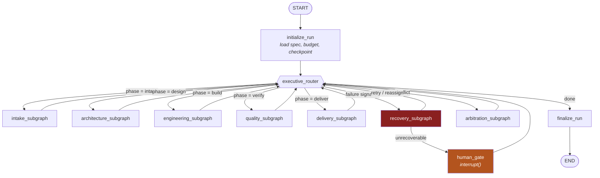

The executive router is a **conditional edge function over persisted state**, not an LLM call in the
common case. Deterministic phase progression is cheaper, faster, and testable; the LLM executive is
invoked only for genuinely ambiguous decisions (which department handles an unusual requirement,
whether a partial failure is acceptable). Every re-entry to `executive_router` increments a visit
counter, and exceeding `MAX_ROUTER_VISITS` forces escalation — this is the structural guarantee
against infinite loops.

### 6.2 Supervisor subgraph shape

Every department supervisor is itself a graph with the same five-node shape. Uniformity means one
set of tests, one mental model, one place to fix a supervision bug.

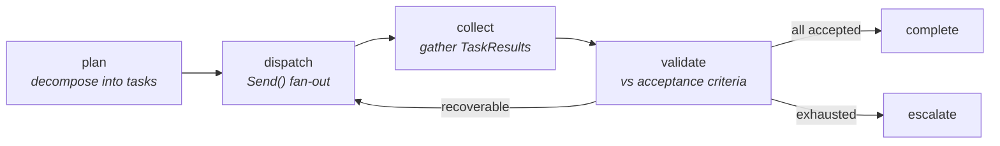

Parallel dispatch uses LangGraph's `Send` API over the ready frontier of the task dependency graph.
`collect` uses an annotated reducer so concurrent writes merge instead of racing.

### 6.3 Graph state

State is a Pydantic model (JSON-serializable — required by the Postgres checkpointer). It holds
**references, not payloads**: a 40-file code generation must not live in a checkpoint row.

```python
class RunState(BaseModel):
    run_id: UUID
    project_id: UUID
    phase: RunPhase
    spec_ref: ArtifactRef | None
    architecture_ref: ArtifactRef | None
    task_graph: TaskGraph
    active_assignments: dict[UUID, AgentRole]
    results: Annotated[list[TaskResult], append_unique]
    decisions: Annotated[list[Decision], append]
    failures: Annotated[list[FailureDigest], append]
    pending_approval: ApprovalRequest | None
    budget: BudgetState
    router_visits: int
    escalation_level: int
```

**Artifacts** (generated files, reports, documents) live in the workspace and in Postgres, addressed
by `ArtifactRef(kind, id, digest)`. Checkpoints stay small and fast.

### 6.4 Persistence and durability

- Checkpointer: `AsyncPostgresSaver` (`langgraph-checkpoint-postgres`) on a dedicated `langgraph`
  schema in the platform database. `.setup()` runs as a deploy step, never lazily at request time.
- `thread_id` = `run_id`. One thread per run, so resume is unambiguous.
- `durability="sync"` for nodes with external side effects (deployment, migration, git push);
  `"async"` for pure reasoning nodes where a lost checkpoint costs only recomputation.
- Connections use `autocommit=True, row_factory=dict_row` as the checkpointer requires.

### 6.5 Interrupt discipline

LangGraph re-executes an interrupted node **from the top** on resume. Three rules follow, and
violating them causes duplicate deployments:

1. Everything before `interrupt()` in a node must be idempotent, or must be moved to a prior node.
2. `interrupt()` is never wrapped in a bare `try/except` — that swallows the control-flow exception.
3. Approval gates are their own dedicated node containing *nothing but* the interrupt and the
   decision branch. Side effects live in the node after the gate.

---

## 7. Human-in-the-loop

### 7.1 What requires approval

Risk is computed by a domain policy (`packages/core/domain/policies/risk.py`), not decided by an LLM.
An agent may *raise* a risk assessment but never lower one.

| Action | Risk | Gate |
|---|---|---|
| Production deployment | HIGH | Always |
| Migration containing DROP/TRUNCATE/destructive ALTER | DESTRUCTIVE | Always |
| Any migration against production | HIGH | Always |
| Creating billable infrastructure | HIGH | Always |
| Secret create/rotate/delete | HIGH | Always |
| Production rollback | HIGH | Always |
| Force-push / history rewrite | DESTRUCTIVE | Always |
| Budget ceiling exceeded | HIGH | Always (raise or stop) |
| Retries exhausted on any task | MEDIUM | Always |
| Arbiter confidence below threshold | MEDIUM | Always |
| Staging deployment, non-destructive migration | LOW | Policy-configurable per project |

### 7.2 Approval flow

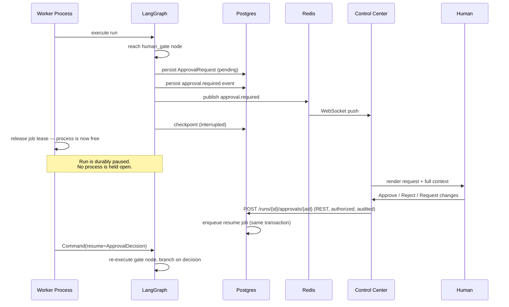

The critical property: **a pause costs nothing**. The worker releases its lease and the run's entire
state lives in the checkpoint. A run can wait three days for approval across a dozen deploys of the
platform itself.

Four decisions are supported: `APPROVE`, `REJECT` (fail the branch, let the supervisor re-plan),
`REQUEST_CHANGES` (resume with human feedback injected into state — e.g. "use PostgreSQL, not
MongoDB"), and `STOP_RUN` (cancel, unwind, mark cancelled).

---

## 8. Security architecture

### 8.1 Trust boundaries

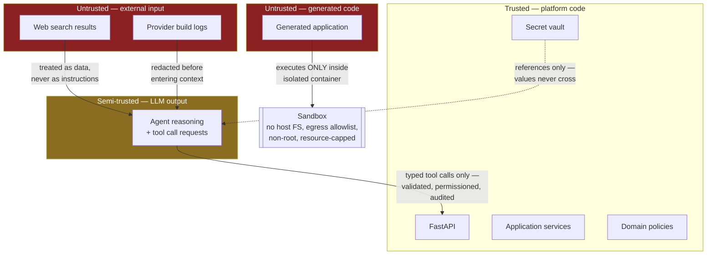

### 8.2 Secrets

Envelope encryption, two layers:

```
SECRETS_MASTER_KEY (KEK)   ── env / KMS, 32 bytes, versioned, never in DB
      └── wraps per-project DEK  ── stored wrapped in project_keys
              └── encrypts secret values  ── AES-256-GCM, per-value nonce
```

Rules enforced in code, each with a test that tries to break it:

1. Secret values are **write-only over the API**. No endpoint returns a value — only name, metadata,
   and whether it is set.
2. Agents receive `secret://project/{project_id}/{NAME}`. The resolver refuses to run inside a
   traced LLM context.
3. Resolution happens at exactly three sinks: provider env injection, migration connection setup,
   sandbox environment. Every resolution writes to `secret_access_log`.
4. A `SecretRedactor` filters all structured logs and is installed as the LangSmith
   `hide_inputs`/`hide_outputs` hook. It scrubs known values plus high-entropy patterns.
5. Per-project DEKs mean a compromised project cannot decrypt another's data.

### 8.3 Generated code execution

Generated code is treated as hostile. The `Workspace` port has one production implementation
(`ContainerWorkspace`) with: no host filesystem mounts beyond the project volume, non-root user,
read-only root filesystem with tmpfs for scratch, dropped capabilities, seccomp profile, CPU/memory/
PID limits, wall-clock kill, and **network egress denied by default** with a narrow allowlist
(package registries only). Remote sandbox providers (E2B, Daytona) plug in behind the same port for
hosted deployments.

Agents never receive a shell. `run_command` accepts only a registered command from an allowlist
(`pytest`, `ruff`, `mypy`, `tsc`, `eslint`, `next build`, `alembic`, pinned `uv`/`pnpm` subcommands)
with structurally validated arguments — no shell interpolation, no `&&`, no pipes.

### 8.4 Prompt injection defense

Generated code, web search results, and build logs can all carry adversarial instructions. Defenses:
untrusted content is wrapped in explicit data delimiters and labelled as data; tool permissions are
enforced by the runtime, so a successful injection still cannot call a tool the agent lacks; all
HIGH/DESTRUCTIVE actions require human approval regardless of how confidently an agent requests
them; and log/search content is truncated and redacted before entering context.

The defense that actually matters is the last one: **injection cannot escalate privilege, because
privilege is not granted by the prompt.**

### 8.5 Project isolation

Every table with project data carries `project_id`. Repository base classes require a project scope
and raise if constructed without one — isolation is a type-level obligation, not a `WHERE` clause
someone might forget. Generated projects get their own Neon project, their own credentials, their
own workspace volume, and their own DEK. Cross-project access attempts are audited and tested.

---

## 9. Data architecture

Platform database: **Neon Postgres**, single driver **psycopg 3 (async)** for both SQLAlchemy and the
LangGraph checkpointer — one pooling story, and psycopg behaves correctly behind Neon's PgBouncer
pooler where asyncpg needs prepared-statement workarounds.

### 9.1 Schema map

**As built (Phase 1).** Four tables exist: `users`, `refresh_tokens`, `projects` and
`audit_log`, created by migration `0001_initial_schema`. Every other table in the map below
belongs to a later phase. Constraint and index names follow the convention declared in
`factory_core.persistence.base`, and an integration test asserts the migrated schema matches
the ORM models — drift there would make every future autogenerated migration wrong.


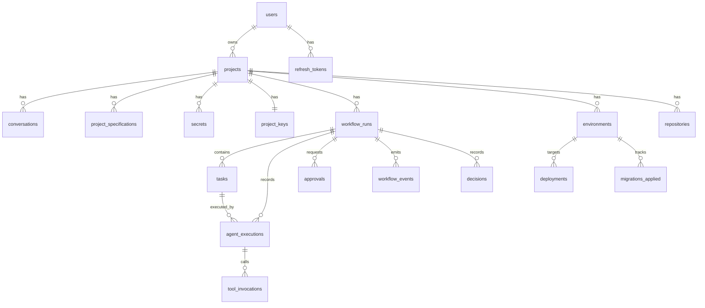

**Table groups and their purpose:**

| Group | Tables | Notes |
|---|---|---|
| Identity | `users`, `refresh_tokens` | Token family + reuse detection |
| Projects | `projects`, `conversations`, `messages`, `project_specifications` | Specs are versioned, never mutated |
| Config | `config_requirements`, `secrets`, `project_keys`, `secret_access_log` | Values encrypted; access logged |
| Orchestration | `workflow_runs`, `tasks`, `agent_executions`, `tool_invocations`, `decisions` | Full execution record |
| Control | `approvals`, `workflow_events`, `jobs` | Events append-only with per-run `seq` |
| Delivery | `repositories`, `environments`, `deployments`, `migrations_applied` | |
| Governance | `audit_log`, `usage_records`, `quotas` | |
| Knowledge | `knowledge_documents`, `knowledge_chunks` (pgvector) | Phase 8 |
| LangGraph | `langgraph.*` | Managed by the checkpointer, never hand-edited |

Indexing follows access paths, not intuition: `(project_id, created_at DESC)` for listings,
`(run_id, seq)` unique for event replay, partial index on `jobs (status, run_after)` for the claim
loop, `(project_id, name)` unique for secrets.

### 9.2 Generated-project databases

Each generated project gets its own **Neon project** — instance-level isolation, independent
credentials, independent billing visibility.

Neon's copy-on-write branching enables the single most valuable safety feature in the system:

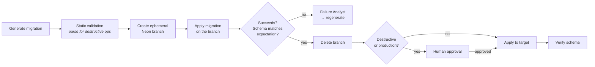

A migration is proven against a real copy of real data before it is ever applied to a real database,
at near-zero cost. This is why Neon is the database choice and not a generic Postgres host.

---

## 10. Realtime architecture

### 10.1 Event model

Events are a Pydantic **discriminated union** on `type` with a common envelope. Internal Python
objects are never serialized to the client.

```python
class EventEnvelope(BaseModel):
    event_id: UUID
    seq: int  # monotonic per run — the replay cursor
    type: EventType
    run_id: UUID
    project_id: UUID
    occurred_at: datetime
    actor: EventActor  # agent role | system | user
    payload: EventPayload  # discriminated on type
```

Event catalog: `workflow.{started,completed,failed,cancelled}` · `phase.{entered,completed}` ·
`supervisor.delegated` · `agent.{started,completed,failed}` ·
`task.{created,started,completed,failed,retrying,reassigned}` · `tool.{started,completed,failed}` ·
`decision.recorded` · `approval.{required,granted,rejected,changes_requested}` ·
`budget.{warning,exceeded}` · `migration.{started,validated,applied,failed}` ·
`deployment.{started,succeeded,failed,rolled_back}` · `healthcheck.{passed,failed}` · `run.log`

### 10.2 Delivery path

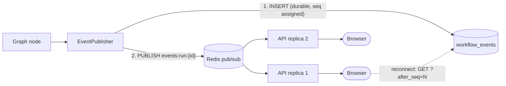

Persist-then-publish, in that order. Redis is a *latency optimization*; Postgres is the truth. A
reconnecting client sends its last `seq` and replays the gap over REST before resuming the socket,
so no event is ever lost — only delayed.

The socket is **server→client only** (plus ping/pong). Every client action is an authorized,
audited REST call. One command path, one place to enforce authorization.

WebSocket authentication uses a short-lived single-use ticket from `POST /ws/ticket` rather than
cookies (CSRF-prone on WS) or query-string tokens (they land in logs).

### 10.3 Caching

Every cache entry must justify itself. Current inventory:

| What | Key | TTL | Invalidation | Why |
|---|---|---|---|---|
| Web search results | `search:{sha256(query)}` | 24h | TTL | Identical research across runs is common and billable |
| Provider metadata (regions, plans) | `provider:{name}:meta` | 1h | TTL | Rarely changes, called often |
| Resolved project config (non-secret) | `cfg:{project_id}:{version}` | 15m | On spec version bump | Read on every node |
| Rate-limit counters | `rl:{scope}:{id}` | window | TTL | — |
| Idempotency records | `idem:{key}` | 24h | TTL | Duplicate provider calls cost money |
| Distributed locks | `lock:{resource}` | lease | Explicit release | One deploy per project at a time |

**Never cached:** secret values, decrypted anything, auth tokens, approval decisions, run state,
per-user authorization results.

Stampede prevention on the two expensive entries (search, provider metadata) via lock-on-miss with a
short stale-serve window.

### 10.4 CDN

Static frontend assets are served through the deployment platform's edge CDN with immutable
fingerprinted asset caching (`max-age=31536000, immutable`) and `no-store` on every authenticated
API response. Generated project artifacts available for download are served through signed,
short-lived URLs — the CDN never caches a private artifact, because the URL is unique per grant.

---

## 11. Observability

### 11.1 Correlation

One identifier chain flows through every layer. A single run is traceable from a browser click to a
provider API call:

```
request_id ──▶ user_id ──▶ project_id ──▶ run_id ──▶ task_id
                                              └──▶ agent_execution_id ──▶ tool_invocation_id
                                              └──▶ langsmith_run_id
                                              └──▶ deployment_id / migration_revision
```

`structlog` binds these into a context variable at process entry (HTTP middleware or job claim), so
every log line inside that scope carries them without being passed explicitly. Logs are JSON, always,
and pass through the `SecretRedactor` before emission.

### 11.2 LangSmith

Every graph node, agent call, and tool invocation is traced, with project/run/task IDs as metadata
and the prompt version recorded on each call. `hide_inputs`/`hide_outputs` hooks apply redaction
before anything leaves the process. `langsmith_run_id` is stored on `agent_executions`, which makes
the platform's own UI able to deep-link into the corresponding trace.

From Phase 8, LangSmith also carries evaluation datasets and evaluators for intake completeness,
routing accuracy, tool selection, plan quality, recovery correctness, and end-to-end success.

### 11.3 Monitoring

Health: `/health` (liveness, no dependencies) and `/ready` (dependency probes with per-dependency
status). Metrics via OpenTelemetry: run outcomes, phase durations, agent success rates, retry counts,
escalation counts, approval latency, tool error rates by class, token/cost per run, queue depth and
job age, WebSocket connections, circuit-breaker state.

Alert on what indicates a broken system rather than a busy one: queue age above threshold, run
failure rate spike, approval-queue starvation, budget-exceeded rate, circuit breaker open, checkpoint
write failures, secret-access anomalies.

---

## 12. Failure and recovery

### 12.1 Error taxonomy

Classification drives handling, so it is explicit and testable:

| Class | Examples | Handling |
|---|---|---|
| `TRANSIENT` | 429, 503, network timeout | Retry with exponential backoff + jitter |
| `CONTRACT` | Malformed structured output, schema violation | Retry once with the validation error fed back |
| `LOGIC` | Tests fail, type errors, build failure | Failure Analyst → targeted fix → retry |
| `RESOURCE` | Budget/quota/timeout exceeded | Escalate to human (raise or stop) |
| `PERMISSION` | Tool not allowed, authz denied | Fail fast — never retried, always audited |
| `EXTERNAL` | Provider outage, invalid credentials | Circuit breaker → escalate |
| `FATAL` | Corrupt state, checkpoint failure | Abort run, preserve state, alert |

### 12.2 Recovery flow

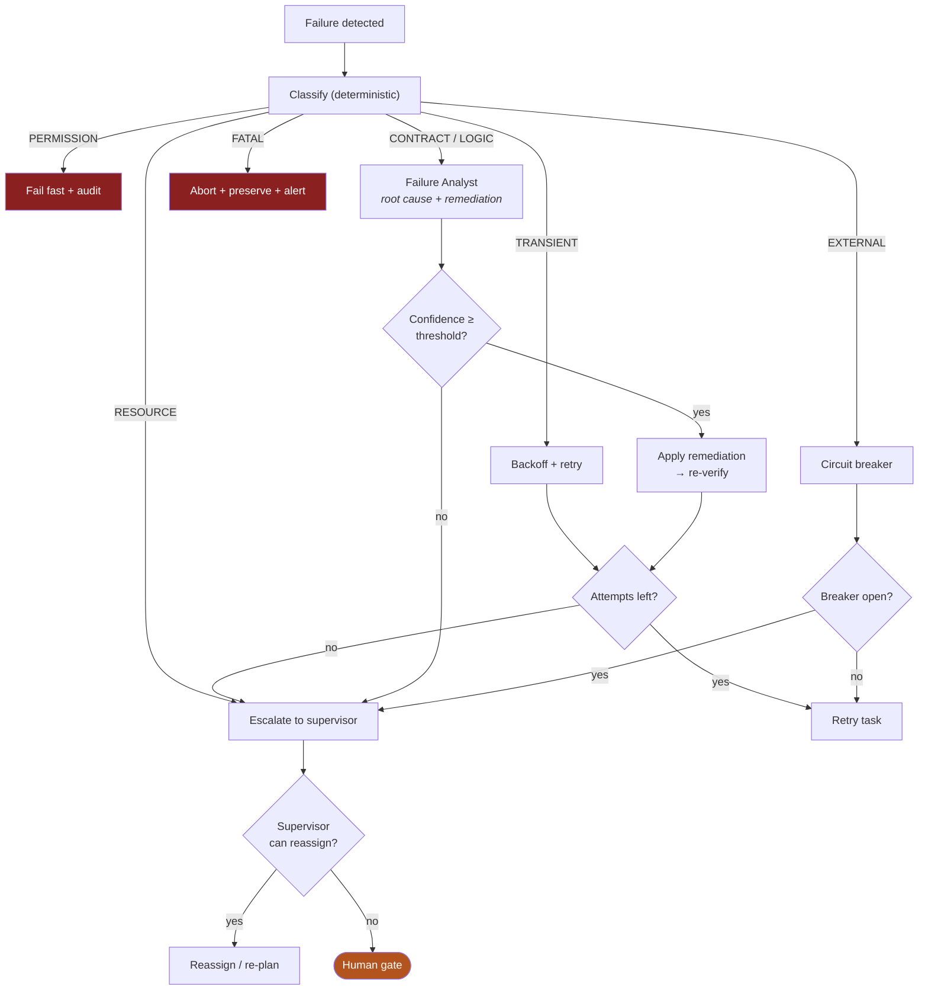

### 12.3 Loop prevention

Four independent guards, because a single guard is a single point of failure:

1. Per-task `max_attempts` (default 3).
2. Per-run `MAX_ROUTER_VISITS` on the executive router.
3. LangGraph `recursion_limit` on every graph.
4. Per-run wall-clock and token budgets enforced by `BudgetGuard` on every model and tool call.

Any guard tripping escalates to a human. **No path in the system retries indefinitely.**

---

## 13. Cost control

`RunBudget` (max tokens, max USD, max wall-clock, max LLM calls, max tool calls) is set at run
creation from project quota and enforced by a `BudgetGuard` callback attached to every model and
tool invocation. At 80% a `budget.warning` event fires; at 100% the run interrupts to a human gate
offering *raise budget* or *stop*.

Model routing is centralized in a `ModelRegistry` mapping role → tier, so cost policy is one file:

| Tier | Used by | Rationale |
|---|---|---|
| `ROUTING` | Classification, routing, gap detection, log triage | High volume, low difficulty |
| `STANDARD` | Most workers, supervisors, reviewers | Default |
| `FLAGSHIP` | Architect, code generation, Failure Analyst, Arbiter | Quality dominates cost here |

Concrete model IDs are configuration, never literals in agent code — the roster changes faster than
the architecture.

---

## 14. External integrations

Every external call goes through a provider client with timeout, bounded retry with jitter, circuit
breaker, idempotency key, and structured error mapping. No agent ever holds a provider credential;
the client resolves it from the vault at call time.

| Provider | Purpose | Port | Phase |
|---|---|---|---|
| OpenAI | LLM inference | `ModelProvider` | 3 |
| LangSmith | Tracing, evaluation | (SDK) | 3 |
| Web search | Research | `SearchProvider` | 4 |
| GitHub | Repos, commits, PRs | `VcsProvider` | 5 |
| Neon | DB provisioning, branching | `DatabaseProvider` | 7 |
| Vercel | Frontend deployment | `DeploymentProvider` | 7 |
| Render | Backend deployment | `DeploymentProvider` | 7 |

`DeploymentProvider` is a port with `create_service`, `set_env`, `trigger_deploy`, `get_status`,
`get_logs`, `rollback`. Adding Railway, Fly, or AWS is a new adapter and a registry entry — no
changes to the Delivery Supervisor.

Outbound HTTP from tools (research, health checks) goes through an SSRF-safe client: scheme
allowlist, DNS resolution with private/link-local/loopback range rejection **checked after
resolution**, redirect limits with re-validation at every hop, response size caps.

---

## 15. Technology decisions

Verified current as of **2026-08-23**. Constraint style is `>=x.y,<next-major` with lockfiles
committed; see [instructions.md](instructions.md) §7 for the upgrade procedure.

| Layer | Choice | Version | Why this and not the obvious alternative |
|---|---|---|---|
| Language (backend) | Python | 3.13 | 3.14 deferred until every dependency ships wheels |
| API | FastAPI | 0.141.x | Async, Pydantic-native, OpenAPI for free. Stays <1.0 — pin tightly |
| Validation | Pydantic v2 | 2.13.x | Also the structured-output boundary for every LLM call |
| ORM | SQLAlchemy | 2.0.5x | Typed `Mapped[]` declarative. **Not SQLModel** — it couples persistence to API schemas, which is exactly the coupling §4 forbids |
| Migrations | Alembic | 1.19.x | The standard; autogenerate is the basis of the migration pipeline |
| DB driver | psycopg 3 (async) | 3.2.x | **One driver for app and checkpointer.** asyncpg is faster but needs prepared-statement workarounds behind Neon's pooler and can't back the checkpointer |
| Database | Neon Postgres | — | Chosen for **branching**: migrations proven on a real copy before application (§9.2) |
| Vector | pgvector | — | Corpus is small (hundreds of chunks). A dedicated vector DB would be infrastructure for its own sake |
| Orchestration | LangGraph | 1.2.x | 1.0+ guarantees no breaking changes before 2.0. Durable checkpoints, native interrupts, `Send` parallelism |
| LLM framework | LangChain | 1.x | Tool + structured-output abstractions only; orchestration is LangGraph's job |
| Observability | LangSmith | — | Tracing *and* evaluation |
| LLM | OpenAI | — | Tiered via `ModelRegistry`; IDs are config |
| Cache/pubsub | Upstash Redis | — | Native pub/sub over TCP; serverless pricing suits bursty load |
| Queue | Postgres SKIP LOCKED | — | Transactional with the domain write. Dedicated brokers matter above ~100 jobs/s; we're 3 orders below that |
| Frontend | Next.js | 16.3.x | App Router, RSC, Server Actions |
| Runtime (frontend) | Node | 24 LTS | |
| Package mgmt | uv / pnpm | latest | Both workspace-aware; never mixed |
| Logging | structlog | — | Structured JSON with bound correlation context |
| Metrics/traces | OpenTelemetry | — | Vendor-neutral |
| Testing | pytest + Vitest + Playwright | — | |
| Quality | ruff, mypy --strict, ESLint, tsc --noEmit, import-linter | — | import-linter enforces §4 layering in CI |

Full rationale for each significant decision, including rejected alternatives, lives in
[`docs/adr/`](docs/adr/) once implementation begins.

### 15.1 Auth transport, as implemented (Phase 1)

ADR-008 chose backend-owned authentication. How the tokens travel was left open; this is
what was built.

The API returns tokens in its **response body** and reads the access token from an
`Authorization: Bearer` header. It sets no cookies, so it stays a plain, directly testable
REST surface with no cookie policy baked in.

The browser never sees a token. `apps/web` is a backend-for-frontend: Server Actions call
the API server-side and store the tokens in **httpOnly cookies** the Next.js server
controls. An XSS bug can run arbitrary code in the page and still not read the session,
because the browser will not hand the cookie to JavaScript.

Cookie scoping matters and is deliberate:

| Cookie | Path | Lifetime | Why |
|---|---|---|---|
| `factory_access` | `/` | 10 min | Sent with every request; short-lived because it is stateless and cannot be revoked |
| `factory_refresh` | `/api/auth` | 30 days | A long-lived credential should not ride along on every request, only where it is exchanged |

Both are `httpOnly`, `sameSite=lax`, and `secure` outside development — `secure` cookies are
dropped over plain http, which would break localhost.

Access tokens are short precisely *because* they are stateless: revocation is not immediate,
so the long-lived half of a session is the stateful, rotating refresh token, where theft is
detectable (§8.2 of the security model, and `factory_core.security.refresh`).

---

## 16. Known risks

| Risk | Impact | Mitigation |
|---|---|---|
| Generated code quality is the whole product | High | Contract-first generation, deterministic scaffolds, mandatory verification gate, bounded fix loop |
| Runaway cost | High | Multi-layer budgets, tiered models, caching, hard interrupt at ceiling |
| Prompt injection via generated code / logs / search | High | Runtime-enforced tool permissions, data delimiters, human gates on all HIGH actions |
| LLM non-determinism breaks tests | Medium | Fake models in unit tests; real models only in a small, tolerant e2e suite |
| Provider API drift | Medium | Adapters behind ports, contract tests against recorded fixtures |
| Checkpoint bloat from large artifacts | Medium | State holds refs only; artifacts in workspace + DB |
| Interrupt re-execution causing duplicate side effects | High | Isolated gate nodes, idempotency keys on every external mutation |
| Long-running runs vs. platform deploys | Medium | Durable checkpoints, graceful worker drain, lease-based job claim |
| Neon branch sprawl | Low | Branches created with TTL metadata and reaped by a scheduled job |

---

## 17. Change log

| Date | Change |
|---|---|
| 2026-08-23 | Initial architecture of record. No implementation yet. |
| 2026-08-23 | Phase 1 implemented. §3.0 and §9.1 describe as-built state; auth transport recorded in §15.1. |
