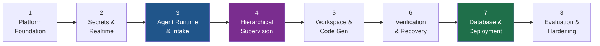

# Implementation Plan — AI Software Factory

> **Current status: PHASE 1 IMPLEMENTED.**
> 14 of 18 Phase 1 features are `VERIFIED`; 4 are `TESTING`, pending a CI run with a
> real database. Phases 2-8 are not started.
> This file is the roadmap of record and must be updated at the end of every phase.

**Companion documents:** [architecture.md](architecture.md) · [features.md](features.md) ·
[instructions.md](instructions.md) · [CLAUDE.md](CLAUDE.md) · [README.md](README.md)

---

## 1. Vision

Build a hierarchical, supervised, multi-agent software engineering organization that converts a
natural-language product request into a deployed, verified, production application — planning,
coding, testing, provisioning, migrating, deploying, and health-checking autonomously, while
escalating every high-risk decision to a human.

The system succeeds not when it generates code, but when it **behaves like an engineering
organization**: work is assigned, validated, rejected, retried, reassigned, and escalated by
supervisors who are accountable for their departments.

### 1.1 Non-goals

Recording these prevents scope drift:

- Not a chatbot, and not a general-purpose coding assistant.
- Not a hosting company — we orchestrate third-party providers, we do not run customer workloads.
- Not multi-tenant-at-scale in v1: single-owner projects, no team/org/RBAC hierarchy (the schema
  leaves room; the features are out of scope).
- Not a mobile or desktop app generator. Generated stack is Next.js + FastAPI + Postgres.
- Not model-agnostic in v1. OpenAI behind a port; swapping providers is future work, not a v1
  requirement that distorts the design.

---

## 2. Architecture summary

Detail in [architecture.md](architecture.md); the shape that governs the plan:

- **Two processes.** A thin FastAPI API and a separate workflow worker, decoupled by a
  transactional Postgres job queue. Long runs survive API restarts.
- **Two Python packages.** `core` (domain, application, persistence, infrastructure — no LangGraph)
  and `agents` (LangGraph graphs, agents, tools — no FastAPI). Enforced by import-linter in CI.
- **18 agent roles.** 1 executive + 4 department supervisors + 13 workers. Every role has a typed
  `AgentSpec` with tools, budget, retry, and escalation declared in code.
- **Uniform supervisor shape.** plan → dispatch → collect → validate → complete/retry/escalate.
- **Failure is control flow.** A seven-class error taxonomy routes to backoff, analyst-driven fix,
  reassignment, or a human gate. Four independent loop guards.
- **Human gates are structural, not decorative.** Risk is computed by domain policy; an agent may
  raise a risk level but never lower one.
- **Secrets never reach an LLM.** Envelope encryption, `secret://` references, resolution confined
  to three audited sinks.
- **Generated code is hostile.** It runs only in an isolated container with egress denied by default.

---

## 3. Phase strategy

Eight phases. Each is independently demonstrable and independently testable. **A phase is complete
only when its acceptance criteria pass**, not when the code compiles.

### 3.1 Ordering rationale — where this plan departs from the obvious sequence

Three deliberate departures, each because retrofitting is more expensive than front-loading:

1. **Realtime and secrets come before agents (Phase 2, not Phase 7).** The moment an agent exists
   you need to watch it, and the moment it touches configuration you need the vault. Retrofitting an
   event bus into working graphs means editing every node; building the bus first means every node
   emits from birth. Retrofitting secret handling means auditing every prompt that already shipped.

2. **Human-in-the-loop is introduced in Phase 3, not Phase 7.** Intake genuinely needs it — the
   Requirements Analyst must stop and ask the user questions. Interrupt/resume is a structural
   property of every graph, so it must exist before the graphs multiply. Treating HITL as a late
   feature produces graphs that cannot pause.

3. **The verification gate (Phase 6) is separated from code generation (Phase 5).** Generation and
   verification have different failure modes and different acceptance criteria. Fusing them yields a
   phase that is "done" when code exists rather than when code works.

### 3.2 Dependencies

| Phase | Requires | Delivers to later phases |
|---|---|---|
| 1 | — | Auth, projects, persistence, contracts, CI, test harness |
| 2 | 1 | Secret vault, event bus, WebSocket, job queue, worker shell |
| 3 | 1, 2 | Model/prompt registries, tool framework, budgets, HITL, first graph |
| 4 | 3 | Supervision, delegation, parallelism, recovery, escalation |
| 5 | 4 | Workspace sandbox, file/git tools, code generation |
| 6 | 5 | Test execution, quality gate, autonomous fix loop |
| 7 | 6 | Neon provisioning, migration pipeline, deployment, health |
| 8 | 7 | Evaluation, RAG, quotas, monitoring, hardening |

---

## 4. Phase 1 — Platform Foundation & Contracts

**Objective.** A secure, observable, fully tested web platform where a user can register, sign in,
and manage projects. Zero AI. This phase exists so that everything after it has somewhere trustworthy
to stand.

**Prerequisites.** Neon account, GitHub repo. No LLM credentials needed.

### Sub-phases

| # | Scope |
|---|---|
| 1.1 | Monorepo: uv + pnpm workspaces, `core`/`agents`/`api`/`worker`/`web` skeletons, ruff, mypy strict, import-linter, ESLint, Prettier/Biome, pre-commit, `.gitignore` |
| 1.2 | Configuration: Pydantic Settings with environment layering, explicit PUBLIC vs SECRET split, fail-fast validation at startup, `.env.example` |
| 1.3 | Persistence: psycopg3 async engine, session/unit-of-work, SQLAlchemy base, Alembic, `users`/`refresh_tokens`/`projects`/`audit_log`, repository pattern with mandatory scoping |
| 1.4 | Authentication: Argon2id hashing, JWT access (10 min), rotating refresh tokens with family reuse-detection, register/login/refresh/logout, `AuthProvider` port |
| 1.5 | Authorization + audit: project ownership guard as a DI dependency, audit-log writer, deny-by-default |
| 1.6 | API skeleton: error envelope with stable codes, request-ID middleware, pagination/filter/sort, OpenAPI metadata, `/health` + `/ready` |
| 1.7 | Observability: structlog JSON, correlation context vars, OTel bootstrap, log redaction filter |
| 1.8 | Contracts pipeline: OpenAPI → `@factory/contracts` TS types, CI drift check |
| 1.9 | Frontend: Next.js 16 App Router shell, auth pages, project list/create/detail, typed API client, loading/error/empty states, design primitives |
| 1.10 | CI: lint, type-check, test, coverage gate, migration check, contract drift check |

### Tests

- **Unit** — config validation/precedence, password hashing, JWT encode/decode/expiry, refresh
  rotation and reuse detection, error mapping, pagination, redaction filter.
- **Integration** — full auth lifecycle against a real Postgres (ephemeral Neon branch or
  Testcontainers); project CRUD; ownership enforcement; audit rows written; migrations up **and
  down**.
- **E2E** — Playwright: register → sign in → create project → see it listed → sign out → session
  rejected.
- **Failure** — DB unavailable at startup (fail fast, clear message); DB drops mid-request (503, no
  leaked stack); expired/tampered/reused token; cross-user project access → 404 not 403 (no
  existence disclosure); missing required env var → startup abort naming the variable.

### Acceptance criteria

1. `uv sync && pnpm install` succeeds from a clean clone on Windows and Linux.
2. One documented command starts API, worker, and web locally.
3. Register/sign-in/refresh/sign-out work end-to-end in a browser.
4. A user cannot read, modify, or discover another user's project — proven by test.
5. Every request carries a request ID that appears in every log line it produces.
6. No secret value appears in any log line — proven by a test that scans captured output.
7. `alembic upgrade head` and `downgrade base` both succeed on a clean database.
8. CI green: ruff, mypy --strict, import-linter, ESLint, tsc --noEmit, pytest, Vitest, Playwright.
9. Coverage ≥ 85% on `packages/core`.
10. No source file exceeds 250 lines (checked by CI).

**Risks.** Windows/POSIX path handling in tooling → verify CI on both. Neon pooler behavior under
async → validate psycopg3 pool config early, in 1.3, not later.

**Rollback.** Phase 1 is greenfield; rollback is `git revert` of the phase branch.

**Docs.** Rewrite `architecture.md` §3, §9.1 to match reality. Set F-1xx features to VERIFIED.
Update `CLAUDE.md` status.

### 4.1 Implementation notes (recorded 2026-08-23)

Three decisions were made during implementation that the plan did not anticipate. Each is
a correction to the plan, not a silent deviation.

**Server Actions instead of route handlers.** The plan implied a REST-ish frontend calling
the API. Next.js 16 Server Actions do the job with less code, work without JavaScript, and
keep tokens server-side. Auth and project mutations are Server Actions; the browser never
calls FastAPI directly. `apps/web/src/lib/actions/`.

**Repository-level dependency injection.** `apps/api/dependencies/repositories.py` was not
in the plan. It exists so tests can replace the database boundary and nothing else,
exercising real routing, real token verification and real service logic without Postgres.
Without that seam the API layer would be untestable except against a live database.

**Event loop selection is a first-class concern.** `factory_core.runtime` exists because
psycopg's async mode cannot use Windows' default `ProactorEventLoop`, and uvicorn selects
its loop through a factory that ignores the asyncio policy. Setting the policy alone fixes
the tests and leaves the API server broken. Both mechanisms are needed; see the module
docstring.

**Test fakes ship inside the package.** `factory_core.testing` is production-packaged test
support so `packages/core` and `apps/api` share one implementation of each fake. Two copies
drift, and a drifted fake tests itself rather than the system.

---

## 5. Phase 2 — Secure Configuration, Secrets & Realtime Backbone

**Objective.** The platform can hold credentials safely, run durable background jobs, and stream
live events to the browser — all before any agent exists to use them.

**Prerequisites.** Phase 1. Upstash Redis instance.

### Sub-phases

| # | Scope |
|---|---|
| 2.1 | Envelope crypto: KEK from config (versioned), per-project DEK generation and wrapping, AES-256-GCM value encryption, key rotation procedure |
| 2.2 | Secret vault: write-only API, `secret://` reference format, `SecretResolver` with sink allowlist and traced-context refusal, `secret_access_log` |
| 2.3 | Redaction: `SecretRedactor` over structlog and (from Phase 3) LangSmith hooks; known-value + high-entropy detection |
| 2.4 | Config requirements: `ConfigRequirement` catalog and per-project satisfaction tracking (which credentials a project still needs) |
| 2.5 | Redis client, rate limiting (per-user, per-IP, per-project), idempotency store, distributed lock |
| 2.6 | Event model: envelope + discriminated payload union, `workflow_events` with per-run `seq`, persist-then-publish `EventPublisher` |
| 2.7 | WebSocket: `/ws/projects/{id}`, ticket auth, connection manager, Redis subscription fan-out, `?after_seq=` replay endpoint, heartbeat, backpressure |
| 2.8 | Job queue: `jobs` table, SKIP LOCKED claim with leases, retry/backoff, dead-letter, idempotency keys |
| 2.9 | Worker process: entrypoint, claim loop, handler registry, lease renewal, graceful drain on SIGTERM. Ships with a `noop` job type to prove the pipeline |
| 2.10 | Frontend: WS client with reconnect + replay, event store, live activity feed, connection status indicator |

### Tests

- **Unit** — encrypt/decrypt round-trip, wrong-DEK failure, key rotation, reference parsing, sink
  allowlist, redactor against a corpus of secret shapes, event schema validation, rate limiter
  windows, lock acquire/expire.
- **Integration** — secret write → resolve at a permitted sink → audit row; resolution from a
  disallowed sink raises; event persisted then published; two API replicas both receive a published
  event; replay returns exactly the gap; queue claim under concurrency delivers each job once;
  crashed worker's lease expires and the job is reclaimed.
- **E2E** — enqueue a `noop` job from the UI, observe live events arrive over WebSocket, kill the
  socket, reconnect, confirm no gap and no duplicates.
- **Failure** — Redis down (events still persist, WS degrades to polling, run unaffected); duplicate
  job delivery is idempotent; malformed event rejected at the boundary; WS auth with expired/reused
  ticket rejected; secret value planted in a log call never appears in output.

### Acceptance criteria

1. A secret can be stored and used, and its value is **not retrievable through any API**.
2. Every secret resolution writes an audit row identifying actor, purpose, and run.
3. Planting a known secret into a log statement produces redacted output — proven by test.
4. A job survives a worker kill and completes on a second worker without duplicate side effects.
5. A browser reconnecting after a 30-second disconnect sees every missed event, in order, once.
6. With Redis stopped, jobs still run to completion and events are still persisted.
7. Rate limits return 429 with `Retry-After`.
8. Coverage ≥ 85% on new `core` modules; CI green; file-size rule holds.

**Risks.** KEK loss makes all secrets unrecoverable → document backup/rotation in
`docs/runbooks/key-management.md` as part of this phase, not later. WS fan-out correctness under
multiple replicas → test with two API processes in CI.

**Rollback.** Feature-flag the WebSocket surface; the platform remains fully usable over REST.

---

## 6. Phase 3 — Agent Runtime & Intake

**Objective.** The first real LangGraph agent. A user describes a project in natural language; the
system identifies what is missing, **pauses to ask**, resumes with the answers, and produces a
validated `ProjectSpecification`. No code generation.

**Prerequisites.** Phases 1–2. OpenAI + LangSmith keys.

### Sub-phases

| # | Scope |
|---|---|
| 3.1 | Model layer: `ModelRegistry` (role → tier → model), centralized client config, timeouts, retry on 429/5xx, `ModelProvider` port |
| 3.2 | Prompt layer: versioned prompt files `prompts/<agent>/vN.md`, `PromptRegistry`, version recorded in state and trace metadata |
| 3.3 | Structured output: Pydantic-validated LLM responses, one repair attempt with the validation error fed back, typed failure after that |
| 3.4 | Budgets: `RunBudget`/`BudgetState`, `BudgetGuard` callback on every model and tool call, warning at 80%, interrupt at 100% |
| 3.5 | Tool framework: `FactoryTool` base (input/output schema, risk level, allowed agents, timeout, retry, side-effect declaration), `ToolRegistry`, **runtime permission enforcement**, `tool_invocations` audit |
| 3.6 | LangSmith: tracing enabled, redaction hooks installed, `langsmith_run_id` persisted on `agent_executions` |
| 3.7 | Run lifecycle: `workflow_runs`/`tasks`/`agent_executions`, `AsyncPostgresSaver` on the `langgraph` schema, run start via job queue, cancellation |
| 3.8 | Intake subgraph: Requirements Analyst → gap analysis → question generation → **`interrupt()`** → answer validation → `ProjectSpecification` (versioned) |
| 3.9 | HITL primitive: `ApprovalRequest`/`ApprovalDecision`, `human_gate` node pattern, REST resume endpoint, resume-job enqueue in the same transaction |
| 3.10 | Chat: project conversation persistence, message history feeding intake context |
| 3.11 | Frontend: chat interface, dynamic question form generated from the agent's structured question set, spec review panel, live run timeline |

### Tests

- **Unit** — model registry resolution, prompt loading/versioning, structured-output success/repair/
  fail, budget accounting and thresholds, tool permission enforcement (allowed and denied), gap
  analysis with a fake model.
- **Integration** — full intake with a scripted fake model: run → interrupt → answers → resume →
  spec persisted; checkpoint written and reloadable; a resumed run continues in a *different worker
  process*; events emitted for every agent/tool boundary; LangSmith metadata attached.
- **E2E** — "Build a restaurant management system with Next.js, FastAPI and PostgreSQL" → questions
  appear in the UI → answers submitted → valid `ProjectSpecification` rendered.
- **Failure** — missing/invalid OpenAI key (clear typed error, no crash); 429 with successful
  backoff; hard timeout; malformed structured output twice → typed failure; budget exceeded →
  human gate; disallowed tool call → `PERMISSION` failure, audited, never retried; run cancelled
  mid-flight leaves consistent state; **interrupt-node re-execution produces no duplicate side
  effects** (explicit regression test).

### Acceptance criteria

1. A vague one-line request produces a specific, relevant question set — not a generic form.
2. The run genuinely pauses: no process is held open while waiting, proven by restarting the worker
   during the pause and resuming successfully.
3. The produced `ProjectSpecification` validates against its Pydantic schema and is versioned.
4. **No secret value appears in any LangSmith trace** — proven by inspecting captured payloads.
5. Every LLM call is attributable to a run, task, and prompt version.
6. Budget exhaustion halts the run and asks a human; it never silently continues.
7. An agent cannot invoke a tool outside its `allowed_tools` — proven by test.
8. Token and cost per run are recorded and queryable.
9. Coverage ≥ 80% on `packages/agents`; CI green; file-size rule holds.

**Risks.** LLM non-determinism destabilizing tests → all deterministic assertions use fake models;
real models appear only in a small, tolerance-based e2e suite excluded from the required CI gate.
Interrupt semantics misunderstood → §6.5 of `architecture.md` is mandatory reading, with a
dedicated regression test for re-execution.

**Rollback.** Intake is additive; disabling the feature flag returns the platform to Phase 2 behavior.

---

## 7. Phase 4 — Hierarchical Supervision & Orchestration

**Objective.** The organization appears. Executive and department supervisors delegate typed tasks,
run independent work in parallel, validate results, retry, reassign, and escalate. Proven with real
outputs (architecture and research) but **no code generation yet** — so supervision is tested in
isolation from generation quality.

**Prerequisites.** Phase 3.

### Sub-phases

| # | Scope |
|---|---|
| 4.1 | `AgentSpec` framework: declarative specs, registry, validation at import time (an agent missing a field fails the build) |
| 4.2 | Delegation contracts: `TaskAssignment`/`TaskResult`, task persistence, dependency graph with cycle detection |
| 4.3 | Supervisor base graph: the uniform plan/dispatch/collect/validate/complete shape, reused by all four departments |
| 4.4 | Executive Supervisor: deterministic phase router with visit counting, LLM-assisted only on ambiguity, run planning |
| 4.5 | Department supervisors: Product, Engineering, Quality, Delivery (Engineering and Delivery initially delegate to stub workers) |
| 4.6 | Parallel execution: `Send` fan-out over the ready frontier, merge reducers, partial-failure handling |
| 4.7 | Error taxonomy + classifier (deterministic), retry policies with jittered backoff, circuit breakers |
| 4.8 | Recovery subgraph + Failure Analyst: root-cause diagnosis with confidence, remediation proposal, escalation ladder |
| 4.9 | Decision Arbiter + arbitration subgraph: conflicting recommendations → justification round → decision with confidence → escalate below threshold |
| 4.10 | Architect worker: architecture document, data model, **the OpenAPI contract**, decisions with rationale |
| 4.11 | Research Agent: SSRF-safe search + fetch tools, source attribution, 24h result cache, invoked only when the Executive decides research is needed |
| 4.12 | Loop guards: `MAX_ROUTER_VISITS`, recursion limits, wall-clock caps — all four guards wired and tested |
| 4.13 | Frontend: live agent hierarchy tree, task board with dependencies, decision log, escalation panel |

### Tests

- **Unit** — spec validation, task decomposition, dependency resolution and cycle detection, each
  error class → correct handling, backoff computation, circuit breaker transitions, arbiter
  confidence thresholds.
- **Integration** — supervisor with scripted workers: happy path, one worker fails → retried, retry
  exhausted → escalated, supervisor reassigns, executive escalates to human; parallel tasks actually
  overlap in time and merge correctly; a dependency cycle is rejected at plan time.
- **E2E** — spec → executive → product supervisor → architect → architecture document + OpenAPI
  contract, with the full hierarchy visible live in the UI.
- **Failure** — every worker fails (graceful run failure, not a hang); router visit limit trips →
  escalation; recursion limit trips → escalation; wall-clock exceeded → escalation; arbiter
  low-confidence → human gate; research provider down → run degrades rather than dies.

### Acceptance criteria

1. Every task in a run is traceable to the supervisor that assigned it and the criteria it was
   validated against.
2. Independent tasks demonstrably execute in parallel (asserted on overlapping timestamps).
3. A failing task is retried with `prior_failures` populated — attempt 2 is measurably different
   from attempt 1.
4. Retry exhaustion escalates through supervisor → executive → human, and never loops.
5. **No configuration of scripted failures produces an infinite loop** — all four guards proven
   independently.
6. Two agents proposing conflicting technologies produce an arbitrated `Decision` with recorded
   rationale and confidence.
7. The UI shows which agent is working, under which supervisor, on which task, in real time.
8. Coverage ≥ 80% on `packages/agents`; CI green; file-size rule holds.

**Risks.** This is the phase most likely to reveal that a supervisor is an LLM wrapper rather than a
supervisor → the acceptance criteria are deliberately behavioral (validation, reassignment,
escalation), not structural. Parallel state merge races → reducers unit-tested against concurrent
writes before use.

**Rollback.** Sequential execution flag disables parallel dispatch without changing graph shape.

---

## 8. Phase 5 — Workspace, Code Generation & Version Control

**Objective.** The factory writes real, structured, reviewed code into an isolated workspace and
commits it to a real repository.

**Prerequisites.** Phase 4. Docker available locally; GitHub token per project.

### Sub-phases

| # | Scope |
|---|---|
| 5.1 | `Workspace` port + `ContainerWorkspace`: non-root, read-only rootfs + tmpfs, dropped capabilities, seccomp, CPU/memory/PID limits, wall-clock kill, **egress denied by default** with a registry allowlist |
| 5.2 | File tools: `read_file`, `write_file`, `apply_patch`, `list_tree`, `delete_file` — all path-confined with traversal rejection |
| 5.3 | Command runner: allowlisted command registry with structurally validated arguments; **no shell, no interpolation, no chaining** |
| 5.4 | Deterministic scaffolds: golden project skeletons for FastAPI and Next.js so the LLM writes feature code, not boilerplate (cheaper, more reliable, reviewable) |
| 5.5 | Database Engineer: SQLAlchemy models, indexes, constraints, relationships, seed data, Alembic revisions |
| 5.6 | Backend Engineer: FastAPI implementation against the Architect's OpenAPI contract; emits `EnvContract` |
| 5.7 | Frontend Engineer: Next.js implementation against the same contract; emits `EnvContract` |
| 5.8 | Contract conformance checker (deterministic): generated backend routes and frontend client verified against `openapi.json` |
| 5.9 | Environment assembly (deterministic): merge `EnvContract`s → `.env.example` + provider env payloads |
| 5.10 | Code Reviewer: correctness, structure, standards, **file-size rule applied to generated code too** |
| 5.11 | Git Agent + `VcsProvider`: init, branch, conventional commits carrying task IDs, GitHub repo creation and push, PR support |
| 5.12 | Artifact storage: `ArtifactRef` model, digests, diff viewing |
| 5.13 | Frontend: file tree, diff viewer, commit history linked to tasks |

### Tests

- **Unit** — path confinement (`../`, absolute, symlink, unicode traversal all rejected), command
  allowlist (injection attempts rejected), patch application/conflict, scaffold golden files,
  conventional commit formatting, env contract merge including conflict detection.
- **Integration** — spec → architecture → generated project on disk; models → migration generated;
  contract conformance detects an intentionally mismatched route; review findings route back to the
  engineer and the fix lands; git history shows task-linked commits.
- **E2E** — inventory-management request → complete repository → pushed to GitHub → clone → install
  → type-check passes.
- **Failure / security** — path traversal, command injection, fork bomb (PID limit), memory bomb
  (OOM kill), infinite loop (wall-clock kill), **unauthorized network egress blocked**, oversized
  file rejected, disk quota enforced. Each of these is an explicit test that must fail to escape.

### Acceptance criteria

1. Generated code appears **only** inside the workspace. No path escapes — proven by an adversarial
   test suite.
2. Generated code cannot reach the network except allowlisted registries — proven by test.
3. Generated code cannot read the host filesystem or platform environment — proven by test.
4. Agents have no shell; every command is allowlisted and argument-validated.
5. A generated project type-checks and its dependencies install cleanly.
6. Frontend and backend agree on the API contract, verified deterministically rather than by
   inspection.
7. Commits are conventional, meaningful, and traceable to task IDs.
8. No **generated** source file exceeds 250 lines, and the Code Reviewer enforces it.
9. Coverage ≥ 80% on new modules; CI green.

**Risks.** Generated code quality is the product's core risk → mitigated by contract-first design,
deterministic scaffolds, and the Phase 6 gate. Sandbox escape is the highest-severity risk in the
system → adversarial tests are acceptance criteria, not extras. Docker-on-Windows differences →
CI covers both, and the runbook documents required Docker settings.

**Rollback.** Generation is gated by feature flag; workspaces are disposable by construction.

---

## 9. Phase 6 — Verification, Security Review & Autonomous Recovery

**Objective.** The factory proves its own output works — and fixes it when it doesn't. Nothing
reaches delivery without passing a gate.

**Prerequisites.** Phase 5.

### Sub-phases

| # | Scope |
|---|---|
| 6.1 | Test Engineer: unit, integration, API, and component tests for generated code, with coverage targets |
| 6.2 | Deterministic runners: pytest, Vitest, ruff, mypy, tsc, ESLint — structured result parsing, not log scraping |
| 6.3 | Dependency audit + secret scanning of generated code |
| 6.4 | Security Reviewer: OWASP-oriented review, authz checks, injection risks, hardcoded credentials — **can hard-block delivery** |
| 6.5 | Quality Supervisor gate: aggregated `QualityReport` and a binary verdict; no bypass path |
| 6.6 | Failure→fix loop: test failure → Failure Analyst → targeted fix by the owning engineer → re-verify, under a strict attempt budget |
| 6.7 | Integration testing of generated apps: backend + ephemeral database, contract tests |
| 6.8 | Regression protection: a fix must not break previously passing tests; the gate re-runs the full suite |
| 6.9 | Frontend: test results panel, coverage display, security findings, live fix-loop visualization |

### Tests

- **Unit** — runner output parsing for pass/fail/error/skip, coverage extraction, finding
  classification, gate verdict logic, attempt budget accounting.
- **Integration** — seed a generated project with a known bug → loop detects, diagnoses, fixes,
  re-verifies; seed an unfixable bug → escalates after budget; seed a security flaw → delivery
  blocked; a fix that breaks another test is caught by the regression re-run.
- **E2E** — full run: generate → test → detect real failures → fix → pass gate.
- **Failure** — test runner times out; runner crashes; flaky test (retried, then quarantined and
  reported, never silently ignored); fix loop exhausted → escalation; security block cannot be
  overridden by an agent.

### Acceptance criteria

1. Generated projects ship with meaningful tests that actually execute.
2. A deliberately introduced bug is found and fixed autonomously, and the fix is verified.
3. An unfixable failure escalates to a human with a real diagnosis, not a stack trace dump.
4. **No agent can bypass the quality gate** — proven by test.
5. A security finding above the configured severity blocks delivery unconditionally.
6. The fix loop is bounded and provably terminates.
7. Fixes never silently break previously passing tests.
8. Coverage ≥ 80% on new modules; CI green.

**Risks.** Fix loops that thrash (fix A breaks B, fix B breaks A) → attempt budget plus a
regression re-run plus escalation on oscillation detection. Flaky generated tests eroding trust →
explicit quarantine-and-report, never silent retry-until-green.

**Rollback.** The gate can be set to advisory in development configuration; it is mandatory in
staging and production configuration.

---

## 10. Phase 7 — Database Provisioning, Migrations & Deployment

**Objective.** The wow moment. Real infrastructure, real deployments, real URLs — with human
approval on every high-risk step.

**Prerequisites.** Phase 6. Neon, Vercel, Render credentials per project.

### Sub-phases

| # | Scope |
|---|---|
| 7.1 | `DatabaseProvider` port + Neon adapter: project creation, connection strings into the vault, connection verification |
| 7.2 | Environment model: dev/staging/production per project, per-environment configuration and credentials |
| 7.3 | Migration pipeline: generate → **static destructive-operation analysis** → dry-run on an ephemeral Neon branch → approval if destructive or production → apply → verify schema |
| 7.4 | Neon branch lifecycle: TTL metadata, reaper job, cleanup on failure |
| 7.5 | `DeploymentProvider` port: `create_service`, `set_env`, `trigger_deploy`, `get_status`, `get_logs`, `rollback` |
| 7.6 | Vercel adapter (frontend) and Render adapter (backend) |
| 7.7 | Deployment Agent: ordered orchestration (database → backend → inject backend URL → frontend), secret injection from the vault, idempotency keys on every mutation |
| 7.8 | Health verification (deterministic): HTTP probes, API docs reachable, database connectivity, auth flow, critical endpoints, with retry-until-healthy and a timeout |
| 7.9 | Deployment recovery: fetch build logs → redact → Failure Analyst → fix → redeploy, capped at 3 attempts then human |
| 7.10 | Rollback: previous-deployment restore, migration down-revision where safe, both approval-gated |
| 7.11 | Approval gates on all HIGH/DESTRUCTIVE actions, with full context rendered to the human |
| 7.12 | Delivery report: URLs, commit SHA, migration count, test summary, health results, deployment ID — **credential-free by construction**, verified by test |
| 7.13 | Frontend: deployment pipeline visualization, approval modals with diffs and risk explanation, live build logs, delivery report page |

### Tests

- **Unit** — destructive-operation detection (DROP, TRUNCATE, type-narrowing ALTER, NOT NULL on
  populated columns), provider request/response mapping, idempotency key generation, health probe
  evaluation, report redaction.
- **Integration** — against recorded provider fixtures: full deploy sequence, failure at each stage,
  rollback; migration dry-run on a real Neon branch catches a bad migration before it reaches the
  target; approval gate blocks until decided; **resume after approval does not duplicate the
  deployment**.
- **E2E** — restaurant management system request → generated → tested → deployed → live URLs
  returned → both URLs respond 200 → API docs load → database connected.
- **Failure** — provider outage, invalid credentials, build failure with successful log-driven fix,
  health check failure → rollback, migration failure → no partial application, approval rejected →
  clean unwind, worker killed mid-deploy → resumes without double-deploying.

### Acceptance criteria

1. A natural-language request results in a live, reachable application.
2. **No destructive or production action occurs without recorded human approval** — proven by test.
3. A bad migration is caught on a branch and never reaches the target database.
4. The delivery report contains no credential — proven by a test that scans it against the vault.
5. Deployment failure is diagnosed from real build logs and fixed autonomously at least once in the
   e2e suite.
6. Rollback restores a working state.
7. Every provider mutation is idempotent under retry and under interrupt-resume.
8. Coverage ≥ 80% on new modules; CI green.

**Risks.** Real money and real infrastructure → all provider tests use recorded fixtures by
default; live tests are opt-in, explicitly flagged, and use disposable resources. Interrupt
re-execution causing double deployment is the highest-consequence bug in this phase → idempotency
keys plus an explicit resume-duplication regression test.

**Rollback.** Deployment is per-project opt-in; the platform is fully usable through Phase 6
capabilities without it.

---

## 11. Phase 8 — Evaluation, Knowledge & Production Hardening

**Objective.** Turn a working system into a defensible engineering product: measured, governed,
monitored, and operable.

**Prerequisites.** Phase 7.

### Sub-phases

| # | Scope |
|---|---|
| 8.1 | LangSmith datasets: 50+ project requests spanning domains and difficulty, with expected decompositions |
| 8.2 | Evaluators: intake completeness, routing accuracy, tool-selection correctness, plan quality, code quality, recovery correctness, end-to-end success |
| 8.3 | Supervisor evaluation: did it pick the right agent, retry appropriately, escalate correctly, validate honestly |
| 8.4 | Regression gate: a sampled dataset subset runs in CI; a quality drop blocks the merge |
| 8.5 | RAG: engineering standards corpus in pgvector, retrieval before generation, policy citation in agent output |
| 8.6 | Cost governance: per-project and per-user quotas, spend dashboard, budget alerts, model-tier tuning informed by evaluation results |
| 8.7 | Monitoring: OTel metrics and traces, SLOs, alert rules, dependency health dashboard, circuit-breaker visibility |
| 8.8 | Platform security review: authz matrix test, dependency audit, SSRF/injection suite, secret-handling audit, threat model in `docs/` |
| 8.9 | Reliability: load and soak testing, connection-pool tuning, graceful degradation matrix, backup/restore and disaster-recovery drill |
| 8.10 | Operations: runbooks (key rotation, stuck run, provider outage, cost spike, incident response), on-call notes |
| 8.11 | Documentation completion: full rewrite of all six root documents against the shipped system |

### Tests

- **Unit** — evaluator scoring, retrieval ranking, quota enforcement, alert-rule evaluation.
- **Integration** — full evaluation suite executes and reports; retrieval measurably improves output
  conformance to standards; quota exhaustion blocks a new run with a clear message.
- **E2E** — five distinct project types complete end to end; results recorded as the quality
  baseline.
- **Failure** — load test at 10× expected concurrency; every dependency failed in turn against the
  documented degradation matrix; restore from backup verified.

### Acceptance criteria

1. Agent and supervisor quality are **measured**, not asserted, with a recorded baseline.
2. A regression in agent quality fails CI.
3. Retrieved engineering standards demonstrably change generated output.
4. Cost per run is visible, attributable, and capped.
5. Every dependency failure has a documented, tested degradation behavior.
6. Runbooks exist for every alert that can fire.
7. All six root documents describe the system that actually exists.
8. CI green; coverage targets met.

**Risks.** Evaluation datasets that encode current behavior rather than desired behavior → author
expectations from the specification, not from observed output. Cost of running evaluation suites →
CI samples; the full suite runs on a schedule.

---

## 12. Testing strategy

| Level | Scope | Speed | Gate | Notes |
|---|---|---|---|---|
| Unit | Pure functions, policies, schemas, single classes | < 5s total | Every commit | No I/O, no LLM. Fake models everywhere |
| Integration | Real Postgres, real Redis, recorded providers | < 3 min | Every commit | Ephemeral Neon branch or Testcontainers |
| Contract | OpenAPI ↔ TS types, provider fixtures | < 30s | Every commit | Drift fails the build |
| E2E | Full user journeys via Playwright | < 15 min | Every PR | Fake models for determinism |
| Failure | Adversarial and fault injection | With integration | Every commit | **Required, not optional** |
| Security | Sandbox escape, traversal, injection, SSRF, authz | With integration | Every commit | Escape attempts must fail |
| Evaluation | LangSmith agent quality | Minutes–hours | Sampled in CI, full nightly | Phase 8 |
| Load/soak | Concurrency, resource limits | Long | Pre-release | Phase 8 |

**Rules that hold in every phase:** every phase ships failure tests; LLM behavior is never asserted
deterministically against a real model; a bug fix begins with a failing regression test; coverage
gates are ≥ 85% (`core`) and ≥ 80% (`agents`, `api`, `worker`).

---

## 13. Major architectural decisions

Full records land in `docs/adr/` during implementation. Summary of what is already decided:

| # | Decision | Rationale | Rejected |
|---|---|---|---|
| 1 | Separate worker process, transactional Postgres queue | Long runs must survive API restarts; enqueue-in-transaction removes dual writes | In-process background tasks; Celery/QStash (extra infrastructure, worse local dev) |
| 2 | `core` and `agents` as separate packages, CI-enforced | Domain logic testable without LLMs; prevents business rules leaking into prompts | Single backend package |
| 3 | psycopg 3 as the only Postgres driver | One pooling story; correct behind Neon's PgBouncer; also backs the LangGraph checkpointer | asyncpg (faster, but two drivers and pooler workarounds) |
| 4 | SQLAlchemy 2.0 + Alembic | Typed declarative mapping; standard migrations | SQLModel (couples persistence to API schemas); raw SQL |
| 5 | Neon, chosen for branching | Migrations proven on a real copy before application | Generic managed Postgres |
| 6 | Backend-owned authentication | Single authority for project isolation; no cross-vendor session translation | Clerk/Better Auth — puts identity in the frontend and still needs backend verification |
| 7 | Envelope encryption + `secret://` references | Values never enter LLM context; per-project DEK limits blast radius | Plain column encryption; external vault (premature) |
| 8 | Deterministic executive router with LLM only on ambiguity | Cheaper, faster, testable; LLMs are bad at bookkeeping | LLM-decides-every-hop |
| 9 | Uniform five-node supervisor shape | One mental model, one test suite, one place to fix supervision bugs | Bespoke graph per department |
| 10 | Contract-first generation (Architect emits OpenAPI) | Removes the Integration Agent entirely; agreement by construction | Negotiating agents |
| 11 | Deterministic scaffolds + LLM feature code | Lower cost, higher reliability, reviewable diffs | Full LLM generation |
| 12 | Server→client WebSocket only; actions over REST | One command path, one authorization point | Bidirectional command socket |
| 13 | Persist-then-publish events with `seq` replay | No lost events; Redis is an optimization, not truth | Redis-only fan-out |
| 14 | Prompts versioned in git | Diffable, reviewable, works offline, recorded per call | LangSmith Hub |
| 15 | pgvector, not a dedicated vector DB | Corpus is small; one fewer system | Pinecone/Qdrant/Weaviate |
| 16 | Postgres SKIP LOCKED queue | Volume is ~3 orders of magnitude below where brokers matter | Redis Streams; SQS |
| 17 | HITL in Phase 3, not Phase 7 | Interrupt/resume is structural; intake needs it immediately | Late HITL retrofit |
| 18 | Container workspace, egress denied by default | Generated code is untrusted; remote sandboxes plug in behind the same port | Host execution; unrestricted Docker |

---

## 14. Progress tracker

| Phase | Status | Started | Completed | Notes |
|---|---|---|---|---|
| 1 — Platform Foundation | **IMPLEMENTED** | 2026-08-23 | 2026-08-23 | 313 backend + 32 frontend tests pass. 37 integration and 10 e2e tests require CI infrastructure. |
| 2 — Secrets & Realtime | NOT STARTED | — | — | |
| 3 — Agent Runtime & Intake | NOT STARTED | — | — | |
| 4 — Hierarchical Supervision | NOT STARTED | — | — | |
| 5 — Workspace & Code Gen | NOT STARTED | — | — | |
| 6 — Verification & Recovery | NOT STARTED | — | — | |
| 7 — Database & Deployment | NOT STARTED | — | — | |
| 8 — Evaluation & Hardening | NOT STARTED | — | — | |

**Update rule:** a phase moves to COMPLETE only when every acceptance criterion has a passing test
and the phase's documentation updates are done. Partial completion is recorded as IN PROGRESS with
explicit notes about what remains. See [instructions.md](instructions.md) §4.

---

## 15. Future work (explicitly out of scope for v1)

Teams, organizations, and RBAC · additional model providers (Anthropic, Google) behind the existing
port · additional deployment providers (Railway, Fly, AWS) · additional generated stacks (Django,
Go, mobile) · self-service plugin API for custom agents · generated-application monitoring after
handoff · marketplace of project templates · fine-tuned models for code generation · multi-region
deployment.

---

## 16. Change log

| Date | Change |
|---|---|
| 2026-08-23 | Initial plan. Eight phases defined. No implementation started. |
| 2026-08-23 | Phase 1 implemented. Deviations recorded in §4.1. |
